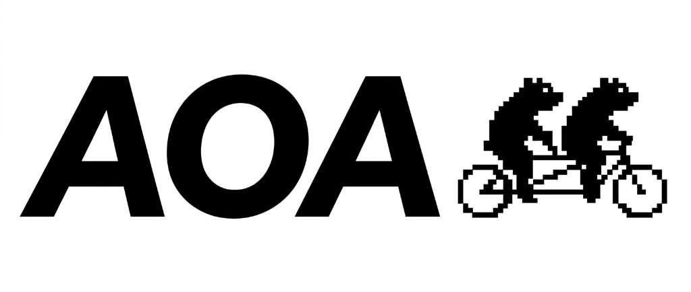

<p align="center">
  
</p>

# Step 11 — Object events

<table width="100%"><tr>
  <td align="left"><a href="step-10-logs.md">← Step 10 — Logs as business events</a></td>
  <td align="center"><a href="../index.md">Contents</a></td>
  <td align="right"><a href="step-12-machine.md">Step 12 — ActionProductMachine →</a></td>
</tr></table>

- [A fact instead of kwargs](#a-fact-instead-of-kwargs)
- [Two switches](#two-switches)
- [@emits: one method](#emits-one-method)
- [events: the whole domain](#events-the-whole-domain)
- [What a refusal does](#what-a-refusal-does)
- [When to emit, and how to take a fact back](#when-to-emit-and-how-to-take-a-fact-back)
- [Everything that is refused](#everything-that-is-refused)
- [Masking, subscriptions and the cache](#masking-subscriptions-and-the-cache)
- [Events in the graph](#events-in-the-graph)
- [Summary](#summary)

---

A log line carries a text for a person and variables for everyone else. In the previous chapter the variables were loose `kwargs`. Here they become a fact with a type: `order_id` can no longer be misspelled, a reader sees in the method's header what it may emit, and a domain can list its facts.

Nothing in the previous chapter stops being true. Everything here is optional, and it switches on one method or one domain at a time.

## A fact instead of kwargs

An event is a class. Its name ends with `Event`, and its fields are typed. It takes the place of `kwargs`, after the text of the line:

```python
# Fragment: one part of an example; `box` comes from the code around it.
from aoa.action_machine.model.base_event import BaseEvent


class OrderCompletedEvent(BaseEvent):
    order_id: str
    total: float


await box.info(
    Channel.business,
    "Order {%var.order_id} total {%var.total}",
    OrderCompletedEvent(order_id="o1", total=9.5),
)
```

The text stays yours, with its variables, colours and `{iif(...)}`. The difference is what a logger receives: `var` is the event itself, so it knows the type of the fact. The same data sent as `kwargs` gives the same line and a dictionary. [`01_event_line.py`](../../examples/step_11_object_events/01_event_line.py) writes each form ([notebook](../../examples/step_11_object_events/01_event_line.ipynb)):

```text
event:
  line: 'Order o1 total 9.5', var: OrderCompletedEvent, level: INFO
  dump: {'order_id': 'o1', 'total': 9.5}
kwargs:
  line: 'Order o1 total 9.5', var: dict, level: INFO
no variables:
  line: 'Order saved', var: dict, level: INFO
event and kwargs:
  EventContractError: An event already holds its data; remove the variables ['extra'].
```

The event already holds its data, so an event together with `kwargs` is refused. So is anything else in the event's place: a class instead of an instance, a dictionary, or an instance of `BaseEvent` itself, which names no fact.

An event has four system fields: `level`, `channels`, `domain` and `domain_name`. `box` fills them in a copy and hands the copy to the logger, so a logger reads `var["level"]` as it always did. They are not yours: setting one is refused, a field with one of those names is refused, and so are fields named `get`, `keys`, `values`, `items` and `resolve`, because a logger reads the event through those methods. A dump leaves the system fields out.

A property marked `@sensitive` on an event is masked, as on `params`. A plain field is printed as it is, like a value in `kwargs`.

Import `BaseEvent` from `aoa.action_machine.model.base_event`.

## Two switches

Lines with `kwargs` stop working only when a switch is on, and there are two switches:

| Mode | Switch | A line with no event | An event in `@emits` | An event not in `@emits` |
|---|---|---|---|---|
| 1 | none | delivered | not applicable | delivered |
| 2, method with `@emits` | `@emits` | refused | delivered | refused |
| 2, other methods | none | delivered | not applicable | delivered |
| 3, method with `@emits` | `events` | refused | delivered; the build guarantees it is in `events` | refused |
| 3, method without `@emits` | `events` | refused | not applicable | refused |

"A line with no event" is a line with `kwargs` or with no variables at all. With neither switch on, everything works as before.

## @emits: one method

`@emits` lists what a method may emit. It works on the five kinds of method that receive `box`: `@regular_aspect`, `@summary_aspect`, `@compensate`, `@on_error` and `@access_decide`. It stands above or below the method's own decorator, once per method.

```python
# Fragment: its imports are left out.
from aoa.action_machine.intents.emits import emits


@summary_aspect("Finalize the order")
@emits(OrderCompletedEvent)
async def finalize_summary(self, params, state, box, connections):
    await box.info(Channel.business, "Order {%var.order_id} completed", OrderCompletedEvent(order_id="o1"))
    return Result(done=True)
```

The declaration says what the method may emit, not what it must: a branch that emits nothing is fine. The rest of the action and the domain do not change. [`02_emits.py`](../../examples/step_11_object_events/02_emits.py) has one typed method beside a plain one ([notebook](../../examples/step_11_object_events/02_emits.ipynb)):

```text
listed:
  check_stock_aspect: 'Stock checked: pen' (dict)
  finalize_summary: 'Order o1 completed' (OrderCompletedEvent)
not listed:
  check_stock_aspect: 'Stock checked: pen' (dict)
  EventContractError: CreateOrderAction.finalize_summary may not write CouponUsedEvent: it is not in the method's @emits.
kwargs:
  check_stock_aspect: 'Stock checked: pen' (dict)
  EventContractError: CreateOrderAction.finalize_summary may not write a line with no event: it is a typed zone.
no variables:
  check_stock_aspect: 'Stock checked: pen' (dict)
  EventContractError: CreateOrderAction.finalize_summary may not write a line with no event: it is a typed zone.
```

`check_stock_aspect` has no `@emits`, so its `kwargs` line goes out every time. A refused line reaches no logger, and the check comes first: a broken template in the same call is never rendered.

The rules cover operation code only. What plugins and the machine write stays as it is. A helper you call with the method's `box` is part of that method. `@emits` has no effect on a method that is none of the five kinds, as with `@context_requires`, and a subclass of an action does not inherit it, because an action's methods are those of its own class.

## events: the whole domain

`events` lists the facts of a domain. Declaring it switches the whole domain on:

```python
# Fragment: its imports are left out.
class StoreDomain(BaseDomain):
    name = "store"
    description = "Storefront operations"
    events = (OrderCompletedEvent,)
```

Now every method of every action in the domain emits only what its own `@emits` lists, and only from the vocabulary. A method without `@emits` writes nothing. `events = ()` is a domain that emits nothing. A domain inheriting from one with `events` inherits them, and declaring its own replaces them.

[`03_domain_events.py`](../../examples/step_11_object_events/03_domain_events.py) walks through the rows of the table ([notebook](../../examples/step_11_object_events/03_domain_events.ipynb)):

```text
@emits, a listed event:
  delivered: 'Order o1 completed' (OrderCompletedEvent)
@emits, kwargs:
  EventContractError: DeclaredAction.write_summary may not write a line with no event: it is a typed zone.
@emits, no variables:
  EventContractError: DeclaredAction.write_summary may not write a line with no event: it is a typed zone.
no @emits, an event:
  EventContractError: UndeclaredAction.write_summary may not write OrderCompletedEvent: it is not in the method's @emits.
no @emits, kwargs:
  EventContractError: UndeclaredAction.write_summary may not write a line with no event: it is a typed zone.
events = (), kwargs:
  EventContractError: ArchiveAction.write_summary may not write a line with no event: it is a typed zone.
a nested action from a domain with no events:
  delivered: 'Legacy line 1' (dict)
@emits outside the vocabulary, at build:
  EventContractError: OutsideAction.write_summary declares CouponUsedEvent, which is not in the events of domain 'store'.
```

Each method answers to its own action and that action's domain, so a nested action from an untyped domain writes as before. The list names exact classes: a subclass of a listed event is not that event. One class may be in the `events` of several domains, because a vocabulary says what a domain allows, not who owns the class. A domain may also list an event no method uses.

> **Warning: switching a domain to mode 3 is a breaking step.** A line with `kwargs` that was legal becomes illegal the moment `events` is declared. The build cannot catch this, because such lines are declared nowhere: the line fails at runtime, on its first call. So convert every method to `@emits` first, and declare `events` last.

**Compensators and error handlers need tests of their own.** They run only on failure, so a `kwargs` line left in one passes the build and every happy-path test, and fails on the day it is needed.

## What a refusal does

A refusal is an ordinary exception, `EventContractError`, so it takes the ordinary path of the method that made it. [`04_refusal_by_kind.py`](../../examples/step_11_object_events/04_refusal_by_kind.py) breaks each kind in turn ([notebook](../../examples/step_11_object_events/04_refusal_by_kind.ipynb)):

```text
regular aspect:
  EventContractError
summary aspect:
  EventContractError
compensator:
  the run answered: handler
error handler:
  OnErrorHandlerError
access decision:
  AccessUndecided
check_access_decide: Undecided
```

| Kind of method | What a refusal does |
|---|---|
| `@regular_aspect`, `@summary_aspect` | the aspect fails as for any error: the saga rolls back, and `@on_error` may catch it |
| `@compensate` | counts as a failed compensation, and the rollback goes on |
| `@on_error` | `OnErrorHandlerError` |
| `@access_decide` | `Undecided` naming the step, which a run raises as `AccessUndecided` |

A handler on `@on_error(Exception)` catches a refusal like any exception. A direct `TestBench` run of an aspect or a compensator has no saga and no handler, so the same refusal reaches the test as it is.

Two things follow from "an event goes out from a method that ran". `@access_decide` is no different from the other kinds: what it emits is delivered on a normal run and in `check_access_decide` alike, so such an event means "a decision was made", not "the operation ran". A result served from the cache delivers no events: the methods did not run, so no fact happened again.

## When to emit, and how to take a fact back

An event goes out at the moment of the call. If a later step fails, the fact has already been delivered: a consumer has emailed "your order is placed", the card is declined, and there is no order. Two rules prevent this, and no buffering is needed.

**Rule 1. Emit a fact only after the steps that can still be rolled back,** usually in the summary aspect. Every step that can fail is then behind you, and the fact is true.

**Rule 2. A published event is never withdrawn; a new fact cancels it.** The old fact happened and stays in history. If what it says is undone later, the compensator emits a new fact. An error handler reports what went wrong in the same way.

[`05_rollback.py`](../../examples/step_11_object_events/05_rollback.py) shows both ([notebook](../../examples/step_11_object_events/05_rollback.ipynb)):

```text
the card is accepted:
  StockReservedEvent: 'Stock reserved for o1'
  OrderCompletedEvent: 'Order o1 completed'
  the run answered: completed
the card is declined:
  StockReservedEvent: 'Stock reserved for o2'
  OrderCancelledEvent: 'Order o2 cancelled'
  CheckoutFailedEvent: 'Checkout failed for o2'
  the run answered: failed
```

`OrderCompletedEvent` appears only when every step succeeded. In the second run the reservation was published, so it is not taken back: `OrderCancelledEvent` follows it. A compensator also runs for the aspect that failed, so here the failing step is a later one, after the reservation succeeded.

## Everything that is refused

Most mistakes never reach a run. [`06_refused_declarations.py`](../../examples/step_11_object_events/06_refused_declarations.py) makes each one ([notebook](../../examples/step_11_object_events/06_refused_declarations.ipynb)):

```text
a name without the suffix: NamingSuffixError
a field named level: EventContractError
a field named items: EventContractError
an author setting level: ValidationError
@emits with nothing: DecoratorArgumentValueError
@emits with a non-event: DecoratorArgumentTypeError
@emits with BaseEvent: DecoratorArgumentTypeError
@emits with a repeated event: DecoratorArgumentValueError
@emits written twice: DuplicateDeclarationError
events as a list: EventContractError
events holding a non-event: EventContractError
events holding BaseEvent: EventContractError
events repeating a class: EventContractError
a class in the event's place: EventContractError
a dictionary in the event's place: EventContractError
a bare BaseEvent in the event's place: EventContractError
```

## Masking, subscriptions and the cache

An event is filtered and masked like any line, and it goes out only from a method that ran. [`07_masking_filters_cache.py`](../../examples/step_11_object_events/07_masking_filters_cache.py) shows the three together ([notebook](../../examples/step_11_object_events/07_masking_filters_cache.ipynb)):

```text
the first call:
  subscribed to business: 'masked 41*****, plain 4111222233334444'
  answered by: method
the second call:
  answered by: cache
```

The logger subscribed to `debug` receives nothing. The property is masked and the plain field is not, so keep a secret behind `@sensitive` or out of the event. The second call is answered by the cache, so no line appears.

## Events in the graph

Everything above also reaches the graph and its JSON, so a tool in any language reads a service's facts from a file, without AOA and without Python. The document is version `1.3` of the [Open Gnomon Protocol](https://github.com/bystrovmaxim/gnomon/blob/main/packages/open-gnomon-protocol/README.md).

[08_events_in_graph.py](../../examples/step_11_object_events/08_events_in_graph.py) ([notebook](../../examples/step_11_object_events/08_events_in_graph.ipynb)) holds every case and prints this:

```text
schema_version: 1.3
Event nodes: ['CouponUsedEvent', 'OrderCompletedEvent', 'RefundIssuedEvent', 'StockCheckedEvent']
PlainDomain: False []
ZoneDomain: False []
StoreDomain: True ['CouponUsedEvent', 'OrderCompletedEvent']
SilentDomain: True []
OutletDomain: True ['CouponUsedEvent', 'OrderCompletedEvent']
ReturnsDomain: True ['RefundIssuedEvent']
CompleteOrderAction:answer_on_error -> OrderCompletedEvent (ErrorHandler)
CompleteOrderAction:decide_access_decide -> OrderCompletedEvent (AccessDecide)
CompleteOrderAction:finish_summary -> OrderCompletedEvent (SummaryAspect)
CompleteOrderAction:release_compensate -> OrderCompletedEvent (Compensator)
CompleteOrderAction:reserve_aspect -> OrderCompletedEvent (RegularAspect)
ZoneAction:finish_summary -> StockCheckedEvent (SummaryAspect)
domains: ['BillingDomain', 'OutletDomain', 'StoreDomain']
order_id: 'The completed order'
total: ''
EventContractError: WrongAction.finish_summary declares StockCheckedEvent, which is not in the events of domain 'store'.
added nodes: ['CouponUsedEvent']
added edges: ['OutletDomain|domain_event|CouponUsedEvent', 'StoreDomain|domain_event|CouponUsedEvent']
```

An event becomes one `Event` node, however many methods and domains name it. A class nobody names stays out, which is why `UnusedEvent` is not in the list. Each case below is what a reader of the file sees:

| Case | `Event` nodes | `@emits` edges | `domain_event` edges | `typed_events` |
|---|---|---|---|---|
| no switch (`PlainDomain`) | none | none | none | `false` |
| `@emits` only (`ZoneDomain`) | those named | yes | none | `false` |
| `events` (`StoreDomain`) | those in `events` and in `@emits` | yes | one per event | `true` |
| `events = ()` (`SilentDomain`) | none of its own | none | none | `true` |
| inherited (`OutletDomain`) | as the parent | its own methods' | one per inherited event | `true` |
| replaced (`ReturnsDomain`) | its own list | its own methods' | one per own event | `true` |

- **`typed_events` tells "no vocabulary" from "an empty one".** Without it both would look the same: a domain with no edges.
- **All five kinds of method give an `@emits` edge:** aspects, summaries, compensators, error handlers and access decisions. The edge says what a method may emit, not what it did.
- **Fields are `Field` nodes, as on params and results,** with the description from `Field(description=...)`. A description is not required: `total` above has an empty one. The system fields of a line never appear.
- **A listed event nobody emits** has a node and a `domain_event` edge and no `@emits` edge, as `CouponUsedEvent` shows.
- **One event in two vocabularies** is one node with two `domain_event` edges.
- **`@emits` outside the vocabulary stops the build,** before the first request. In a domain with no vocabulary there is nothing to break, so the build passes.
- **Two versions of a graph compare as usual.** An event and its edges have stable ids, so they show as added or removed like any other element.

Until the viewer learns about events, Maxitor draws them on the full graph with no icon of their own. An event of a domain without a vocabulary stands in *Outside domains*, because no domain holds it.

## Summary

- An event takes the place of `kwargs`; the text stays yours, and a logger receives the fact with its type.
- With no switch on, nothing changes. Lines with `kwargs` are a form that stays.
- `@emits` makes one method a typed zone; `events` makes a whole domain one. Convert methods first, and declare `events` last.
- A refusal reaches no logger and takes the ordinary path of the method that made it.
- Emit after the steps that can fail, and cancel a published fact with a new one.
- The graph and its JSON carry every event, what each method may emit and each domain's vocabulary, and `@emits` outside a vocabulary stops the build.

---

<table width="100%"><tr>
  <td align="left"><a href="step-10-logs.md">← Step 10 — Logs as business events</a></td>
  <td align="center"><a href="../index.md">Contents</a></td>
  <td align="right"><a href="step-12-machine.md">Step 12 — ActionProductMachine →</a></td>
</tr></table>
