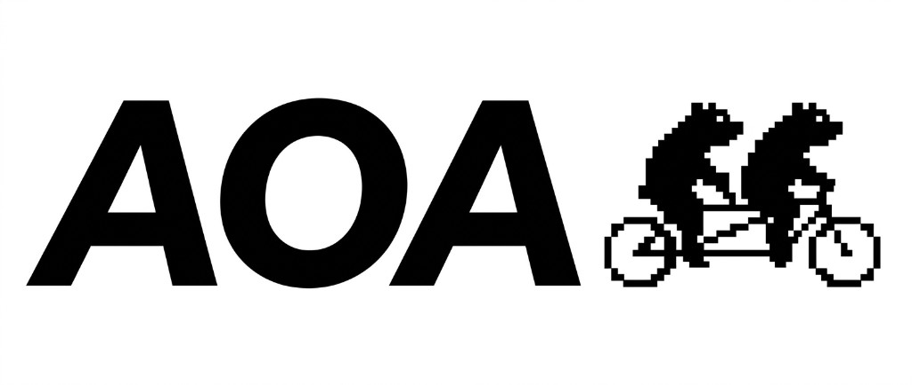
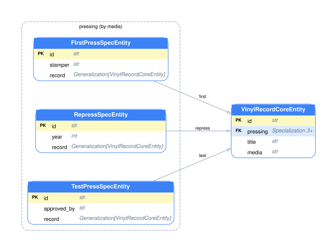

<!-- translated-from: step-26-maxitor_draft.md @ 2026-06-17T17:53:37Z · sha256:07a023a2b3e7 -->
<p align="center">
  
</p>

# Step 26 — Maxitor: a system you can see

<table width="100%"><tr>
  <td align="left"><a href="step-25-context.md">← Step 25 — Context</a></td>
  <td align="center"><a href="../index.md">Contents</a></td>
  <td align="right"><a href="../index.md#ready-extensions">Ready extensions →</a></td>
</tr></table>

- [Four projections of one system](#four-projections-of-one-system)
- [The full graph](#the-full-graph)
- [ERD, use case, and lifecycle](#erd-use-case-and-lifecycle)
- [It's the same graph the machine builds](#its-the-same-graph-the-machine-builds)
- [Dictionaries in the entity diagram](#dictionaries-in-the-entity-diagram)
- [Specialization: the variants in one frame](#specialization-the-variants-in-one-frame)
- [Maxitor as an AOA application](#maxitor-as-an-aoa-application)
- [Looking at one service together](#looking-at-one-service-together)
- [Graphs that follow their services](#graphs-that-follow-their-services)
- [How to run it](#how-to-run-it)
- [Invariants](#invariants)
- [Review questions](#review-questions)

---

Architecture diagrams usually live in Confluence or Miro and go stale faster than they are drawn: a month after release new domains appeared, steps were renamed, dependencies changed — and the diagram stayed the same. The gap between what is written and what runs is a familiar trouble.

**Maxitor** breaks this cycle: the diagrams are not drawn by hand — they are **generated by the same code that runs**. Everything you declared through intents throughout this guide (`@meta`, `@check_roles`, `@depends`, aspects, `@entity`, relations, `Lifecycle`) automatically lands in the graph. The code changes — the diagram changes; open the browser — you see the current system.

[▶ Try in Colab](https://drive.google.com/file/d/1CjkB2PVUmm95VFpSELBP88a1m5SBbKSm/view?usp=drive_link) · [Open in project](../../examples/step_26_maxitor/01_graph.py)

---

## Four projections of one system

Maxitor shows the system from four sides — and all of them are built from the same code:

| Projection | What it shows |
|------------|---------------|
| **Full graph** | everything: domains, Actions, pipeline steps, resources, dependencies, relations |
| **ERD** | entities, fields, relations, and cardinality by domain |
| **Use case** | roles and the Actions available to each role |
| **Lifecycle** | the finite-state machine of a specific entity |

This echoes [The system from different altitudes](../explanation/system-altitudes.md): Maxitor builds the first projections from code automatically.

**Moving around.** On every diagram a drag, a two-finger swipe on a trackpad or a plain mouse wheel moves the picture; a pinch, or Ctrl / ⌘ with the wheel, zooms it at the pointer; Shift with the wheel moves it sideways. That is how design tools and the platforms' own trackpads behave. On a phone one finger moves and two fingers zoom.

## The full graph

The full graph is an interactive network of all the system's elements. Nodes of different types, each with its own color: **Domain** (groups Actions), **Action**, **RegularAspect/SummaryAspect** (pipeline steps), **Compensator** (saga rollbacks), **ErrorHandler**, **Resource** (`@depends`), **Entity/EntityField** (the data model), **Lifecycle**, **Role**, **Params/Result/Field** (the operation's contract). The left panel filters by group, the graph can be zoomed, a cluster isolated.

The effect is simple: a new developer understands the system's structure in five minutes without reading code, and a reviewer sees what changed without diffs across dozens of files.

## ERD, use case, and lifecycle

- **ERD** (entity–relationship diagram) is built from [`BaseEntity`](step-20-entity.md) classes and [relations](step-21-relations.md): which entities are in a domain, their fields and types, how they connect (`AssociationOne/Many`, `Aggregate…`, `Composite…`), direction and cardinality. No YAML — you write code, you get the schema.
- **Use case** is read straight from the [`@check_roles`](step-03-authorization-and-roles.md) annotations: who can call which operations. This is a ready access audit — an answer to "can a manager do this?" without opening the code.
- **Lifecycle** for each entity with a [`Lifecycle`](step-22-lifecycle.md) field draws a finite-state machine: states, transitions, initial and final vertices. Especially useful when there are a dozen statuses.

## It's the same graph the machine builds

Maxitor invents nothing: it displays the graph the [machine](step-11-machine.md) assembles from code via `NodeGraphCoordinator` — the very one that checks [relations](step-21-relations.md) and [automata](step-22-lifecycle.md) at startup and feeds the access matrix. The graph is available from code right now, without a browser:

**Run:**

```bash
uv run python examples/step_26_maxitor/01_graph.py
```

**Output:**

```text
Graph assembled from code: 28 nodes, 35 edges

Node types (what the Full-graph view shows):
  Action           1
  Application      1
  Checker          1
  Domain           1
  Entity           2
  EntityField      5
  Field            2
  Lifecycle        1
  Params           2
  RegularAspect    1
  Resource         1
  Result           2
  Role             3
  StateFinal       2
  StateInitial     1
  StateIntermediate 1
  SummaryAspect    1

Edge types (relations Maxitor draws between them):
  @check_roles     1
  @depends         1
  @regular_aspect  1
  @result_checker  1
  @summary_aspect  1
  application      4
  domain           4
  entity_field     5
  entity_relation  2
  field            2
  generic:params   1
  generic:result   1
  lifecycle        1
  lifecycle_contains_state 4
  lifecycle_transition 6

No diagram was drawn by hand — this is the running system's own graph.
```

You can see how each declared intent became a node or an edge: the domain and the role, the `@depends` resource, both aspects and the checker, two entities with five fields and a relation, the order automaton with states and transitions. This is exactly what Maxitor unfolds into four projections.

## Every edge has an id

A node has always had an id: the qualified name of the code that declares it. An edge has one too, so two versions of a graph can be compared edge by edge — what was added, what was removed, what changed. The id is built from fields the edge already exports:

- by default, `<source_id>|<type>|<target_id>`;
- a relation is named by its field instead of its target, `<source_id>|entity_relation|<field_name>`: an entity can hold two relations to the same entity, and a relation that starts pointing at another entity is still the same relation — it changed, it was not removed and added;
- a lifecycle transition appends the state it leaves, `…|<target_id>|<from_state>`: a state can be entered from two states.

The two special rules are declared on their edge classes (`EDGE_TYPE` and `ID_RULE`), and one public function, `edge_id(row)` in `aoa.action_machine.graph.edge_identity`, computes the id from an exported edge row. The graph build refuses what would make an id ambiguous: two edges with one id fail with `DuplicateEdgeError`, which names both, and a `|` inside a node id or inside a property used in an id fails with `InvalidGraphError`. An edge type that can repeat between the same two nodes therefore has to say what tells the repeats apart before the graph builds.

For a reader, the export's format is now `1.1`: every edge carries `id`, edges come in `id` order, and the published JSON schema requires the field. A reader that takes edge fields by name needs nothing; Maxitor draws every diagram exactly as before. A file of format `1.0` has no `id` and does not pass the `1.1` schema; read it by computing each edge's id with `edge_id(row)` — the same function the export uses, so the ids are the same. [11_edge_ids.py](../../examples/step_26_maxitor/11_edge_ids.py) ([notebook](../../examples/step_26_maxitor/11_edge_ids.ipynb)) shows every case on the demo graph:

```text
2. A relation is named by its field
   AssuranceDelegatedWorkTicketCoreEntity|entity_relation|assignee_actor
   AssuranceDelegatedWorkTicketCoreEntity|entity_relation|delegator_actor
   pointing at another entity, the same id: True
3. A transition appends the state it leaves
   DiscountApplicationCoreEntity:lifecycle:lifecycle:cancelled|new
   DiscountApplicationCoreEntity:lifecycle:lifecycle:cancelled|payment_pending
4. Two edges with one id
   DuplicateEdgeError: Edge id conflict 'shop.Order|uses|shop.Stock':
     first edge:  shop.Order -[uses]-> shop.Stock
     second edge: shop.Order -[uses]-> shop.Stock
   Declare an ID_RULE on the edge class that tells these edges apart.
6. A file of format 1.0
   4841 edges without id, ids computed: 4841, equal to the written ones: True
```

## The graph saved with every change

Maxitor shows a graph as it is now. To see how it got there, the graph has to be kept — and kept by the code that produces it, not by hand. Each service of this repository saves its current graph in one file, `packages/aoa-demo/graph.json` and `packages/maxitor/graph.json`, listed in `gnomon.toml` at the root:

```toml
gnomon = "1.0"

[[graph]]
name = "demo"
build = "uv run --extra dev python -m aoa.demo.build_graph"
file = "packages/aoa-demo/graph.json"
```

`build` prints the graph — `aoa.demo.build_graph` is a few lines that register the demo's model and write `to_json()` — and `gnomon write` saves it with sorted keys and an indent of two, so the same graph always gives the same bytes and an unchanged graph leaves its file untouched. Each graph is built in a process of its own: the demo built with Maxitor imported would carry Maxitor's own actions too. The format and the command belong to [maxitor](../../packages/maxitor/README.md), which knows nothing about AOA; `GRAPH_JSON_SCHEMA` is read from there, schema version `1.1`.

How the graph travels with a pull request: you change the code; the check run's last step runs `gnomon write` — only when every other step passed; you commit the changed `graph.json` with the code; CI runs `gnomon check`, which builds the graph again, writes nothing and fails on a stale file, naming what changed by id:

```text
stale demo: packages/aoa-demo/graph.json
  nodes[id=aoa.demo.model.clinical_supply.entities.cs_inbound_shipment_ticket.ClinicalInboundShipmentTicketCoreEntity].properties.description: Inbound partner lot keyed to SKU and packing posture (suppl… → Inbound partner lot keyed to SKU
ok maxitor
run: gnomon write --config gnomon.toml, and commit the graph files
```

Merged, the pull request carries the graph as it now is; `git log -p packages/aoa-demo/graph.json` is the demo's graph history. [12_graph_file.py](../../examples/step_26_maxitor/12_graph_file.py) ([notebook](../../examples/step_26_maxitor/12_graph_file.ipynb)) shows every case:

```text
3. Built again
   the same bytes as the file: True
4. A stale copy
   stale
     edges[id=aoa.demo.model.telemetry_pipeline.telemetry_pipeline_domain.TelemetryPipelineDomain|application|aoa.action_machine.application.application.Application]: added
     nodes[id=aoa.demo.model.store.store_domain.StoreDomain].label: Shop → StoreDomain
5. Another indent
   stale: only the formatting differs
6. An unknown version
   GraphRefused: graph 9.9: unknown schema version '9.9'; known: 1.0, 1.1
```

## Dictionaries in the entity diagram

An **entity–relationship diagram**, or **ERD**, describes the declared domain model.
Each table-shaped card represents an entity class; its rows describe fields. The shape
does not prove that a database table exists. `PK` and `FK` are diagram hints, not generated
database constraints.

A closed dictionary is one entity class with several declared values. In the diagram it is an
ordinary entity card: its header and its own field rows — an identifier, an obsolescence flag,
whatever the dictionary declares — and nothing more. The values it accepts are **not drawn**: no
row per value, no descriptive properties, no codes, and nothing standing in for them such as a
count. A dictionary of three values and one of ninety-three therefore look the same, which is what
keeps a real catalogue — a list of regions, say — from setting the height of the whole diagram.
The values are still in the graph and in the ERD response for anything that needs them, and the
[next section](#follow-one-property-across-the-boundary) follows a value's properties across that
boundary.
The values are not separate cards or graph nodes. A dictionary selection uses an explicit ordinary relationship, including One/Many and ownership containers. Its retained field row shows the
field's type; the line drawn from that row to the dictionary's table says what it references. The current payload also contains
a synthesized FK row for the same field; this duplication is a confirmed limitation, not two
separate domain fields.

The [dictionary ERD script](../../examples/step_20_dictionaries/09_erd.py) and
[notebook](../../examples/step_20_dictionaries/09_erd.ipynb) build a small currency/price
model and pass its actual graph through Maxitor's query. They print:

```text
{'code': 'eur', 'display_name': 'Euro', 'properties': [{'name': 'symbol', 'value': '€'}]}
CurrencyEnumEntity
Currency field rows: 2
Relation: currency (one) -> CurrencyEnumEntity
```

### Follow one property across the boundary

The graph is a model description. Its dictionary reference keeps properties as an object:

```json
{"code": "eur", "display_name": "Euro", "properties": {"symbol": "€"}}
```

`to_reference()` produces this data in JSON mode. Dates, Decimal values and tuples are
converted to JSON-compatible values, and a field serializer determines the exported
representation of its field. The [serializer example](../../examples/step_20_dictionaries/12_field_serializer.py)
([notebook](../../examples/step_20_dictionaries/12_field_serializer.ipynb)) demonstrates
this before any viewer is involved. Maxitor receives the saved values; it does not
reconstruct Python dictionary classes or rerun their serializers.

The ERD response serves a different purpose: it provides display rows. Its schema must
name the keys of every object, while a dictionary may declare arbitrary property names.
The server therefore turns the property object into a list with one fixed item shape:

```json
{"code": "eur", "display_name": "Euro", "properties": [{"name": "symbol", "value": "€"}]}
```

Both item fields are strings. A string property remains its text. Other JSON values are
rendered with JSON notation: `true`, `42`, `null` or `["a", "b"]`. The renderer displays
each name/value pair beneath the value's label and escapes both strings, so a note such
as `<safe> & readable` appears as text rather than diagram markup. A value with no extra
properties has `properties: []` and still shows its label and keeps its code in the tooltip.

This conversion belongs to the ERD response; the graph keeps the original properties
object. The payload also retains `entity_kind`, `values` and a referencing field's
`reference_qualname`. It requires neither a `properties_json` field nor a predefined list
of domain fields. Existing graph files that already contain the properties need no
rebuild merely to show them. A graph that omitted data cannot recover that data in the viewer.

The backend checks the response against its schema, and the client check exercises the
actual Graphviz SVG output, including escaped property text. These are different
boundaries: successful reference serialization alone does not prove that a property
survives the query and appears in the card.

## Specialization: the variants in one frame

### Read the entity diagram before interpreting its arrows

The [record model](step-21-relations.md#generalization-and-specialization) has a head,
`VinylRecordCoreEntity`, with common record information. Its first-pressing, re-pressing and
test-pressing classes contain the alternative sets of specific data. The `pressing` field
and `VinylRecordKindEnumEntity` dictionary form one **axis**: one declared choice among
those classes.

The head has one `pressing` row. It has no additional `media` selector, because the selected
value belongs to the specialization container. The ERD groups the three alternatives in a
dashed frame labelled `pressing (by VinylRecordKindEnumEntity)`. That frame represents a
choice; it is not another entity and does not mean all alternatives are loaded at once.

### Generate the diagram data from the working model

The [script](../../examples/step_21_relations/13_specialization_erd.py) and
[notebook](../../examples/step_21_relations/13_specialization_erd.ipynb) contain the complete
five-class model: dictionary, head and three alternatives. Run the script from the
repository root:

```bash
uv run python examples/step_21_relations/13_specialization_erd.py
```

It builds AOA's graph, loads the exported metadata into `DuckDBGraphResource` and asks
`ListEntitiesAction._slice_payload` for the ERD projection. This is the internal query
used by the viewer; the example uses it to inspect the diagram without starting an HTTP
service. It is not a public persistence API for application data.

Output:

```text
pressing
FirstPressSpec (first) | RepressSpec (repress) | TestPressSpec (test)
Groups: 1
Alternatives: 3
Group links: 1
Saved: examples/step_21_relations/02_specialization_erd.json
```

`entities` supplies cards, `groups` supplies visual frames and `relations` supplies drawing
connections. The type text lists class display names and their declared codes; the `Entity`
suffix is omitted in that text. The dictionary supplies alternative order, while each
alternative's marker determines its corresponding code.

### One layer owns the group label

The server builds the complete `label`; the client escapes and renders that label. There
is no separate `dictionary_label` in the ERD group payload for the client to append.
The dictionary metadata remains in the graph's specialization edges, where it describes
the model rather than prescribing display text.

The [group-label script](../../examples/step_21_relations/51_group_label.py) and
[notebook](../../examples/step_21_relations/51_group_label.ipynb) use the same record model
but inspect only this contract:

```text
Label: pressing (by VinylRecordKindEnumEntity)
Separate dictionary label: False
```

The label is `pressing (by VinylRecordKindEnumEntity)` once. The server's query still
uses graph metadata to compose it; the client does not try to reconstruct it. The
`classifier_field` compatibility member remains in the group and is normally null for
a dictionary-classified axis. No separate classifier field is added to the head entity.

### Inspect the actual rendered picture



The dictionary card lists first, repress and test. The alternatives remain separate cards
inside the frame, so their fields—stamper, year and approved_by—remain readable. The head
sits outside that frame. Its field is summarized as `Specialization 3+`; the tooltip holds
the full mapping. Generalization arrows lead from the alternatives back to the head.
The payload's group-directed connection is a rendering instruction, not an extra object.

To regenerate the image after the Python script, use the installed client dependencies:

```bash
node examples/step_21_relations/render_specialization_erd.mjs
```

This writes the [DOT source](../../examples/step_21_relations/02_specialization_erd.dot)
and [SVG image](../../examples/step_21_relations/02_specialization_erd.svg) from the saved
[JSON payload](../../examples/step_21_relations/02_specialization_erd.json), using Maxitor's
current `buildDotSource` and Graphviz renderer. Graphviz is the program that positions the
cards and arrows; DOT is its input language.

### What happens when there is only one alternative?

A dictionary with one value can classify `Specialization[FirstPressSpecEntity, Dictionary]`.
There is a relationship, but there are no competing alternatives to enclose in a frame.
The [single-alternative script](../../examples/step_21_relations/14_specialization_single_alternative.py)
and [notebook](../../examples/step_21_relations/14_specialization_single_alternative.ipynb)
use a complete model with only that value and class. They print:

```text
Groups: 0
Relation lines: 1
```

The single relation is the reverse generalization. No multi-alternative group is created.
Similarly, filtering a multi-alternative frame down to fewer than two visible members
removes the frame from the view; it does not change the declaration.

`NoGraphEdge` on the head field suppresses the forward specialization edges needed to
build a group, while preserving the field and reverse edges. The
[focused example](../../examples/step_21_relations/12_specialization_hidden_edges.py) shows
these counts independently of rendering.

### Why the full graph looks different

The logical graph contains entity and field nodes and their declared relationships. The
ERD adds display groups to those data. The full-graph view has no ERD frames: it retains
forward `entity_specialization` associations and filters edges whose relationship is
`Generalization`, including reverse `parent_entity` edges.

These are different presentations of the same model. Neither view loads business rows,
selects a variant or validates stored data. The
[container examples](step-21-relations.md#generalization-and-specialization) explain those
separate runtime operations.

## Maxitor as an AOA application

A nice detail: Maxitor itself is written in AOA. Its backend is operations exposed through [`FastApiAdapter`](step-13-fastapi.md), and it keeps the graph as a snapshot in DuckDB:

```text
AOA code (domains, Actions, entities)
        ↓
NodeGraphCoordinator — walks all elements
        ↓
snapshot in DuckDB
        ↓
FastAPI Action → JSON endpoints
        ↓
React SPA (G6 + Graphviz WASM)
```

The diagram endpoints (`GET /api/v1/full-graph`, `…/list-entities`, `…/domain-use-case-diagram`, `…/lifecycle-finite-automaton`) are ordinary AOA operations. Their JSON can be embedded into your own portal, CI pipeline, or documentation generator. The React SPA is a separate process, and in production the static assets can be served from a CDN while the API stays next to the service.

## What a built graph costs

A built graph lives in DuckDB. Until #268 most of its memory was not data: the build created 21 primary keys and 64 indexes, and on the reference service they took 38 of 43.5 MiB — 87 %. Yet they were never read: every plan of all six diagram queries and the sidebar build is a sequential scan ([the index usage table](../../specs/025-graph-index-memory/index-usage.md)).

The build now creates neither. The reference graph takes 13.4 MiB instead of 43.5, and the demo's graph 20.4 instead of 65.4. Per held graph the process gains 24.5 MiB instead of 53.4 on macOS, and 16.7 MiB on Linux, so at the store's limit of fifty graphs the process holds about 1.1 GiB instead of 2.7. The build is also faster (109 ms instead of 125 ms on the reference), and every diagram answer stays byte for byte the same.

One protection moved rather than disappeared. A primary key used to refuse a graph that lists the same node id twice in one table; the build now checks for that after loading and names the id and the table. A repeated id in two *different* tables is still accepted, as it always was.

[03_graph_memory.py](../../examples/step_26_maxitor/03_graph_memory.py) and its [notebook](../../examples/step_26_maxitor/03_graph_memory.ipynb) show the cost by memory tag, the refusal, the cross-table case and an empty graph, with the output they print. On Linux the process returns the memory to the system when graphs are dropped; on macOS it keeps its peak. The [`maxitor` README](../../packages/maxitor/README.md#backend) says what that means for the fifty-graph limit.

## Looking at one service together

A **room** lets several people look at one service at once. It changes nothing in the service and copies no graph: the people in it see the same diagrams, each other's pointers, and one set of filters.

**Opening and joining.** **Open room** in the row above the diagram asks for a name and opens a room for the service on screen; the address gains `room=<id>` and a card offers the link. The id is 128 random bits, so the link is the invitation. Whoever opens the link is asked for a name — *Everyone with the link sees your name and your pointer* — and joins. Each person gets a colour of their own; the row shows a circle per person, yours first and ringed, and folds the rest into **+N** beyond five (three on a phone). **Copy link** hands out the page you are on, not the one the room was opened on; **Leave room** keeps that page, its filters and its zoom.

**What is shared, and what is not.** Every filter and layout mode of a page is the room's: switch the ERD to Neato and everyone on that page sees Neato; a later joiner opens it that way. A change travels as the new value, never as a toggle, so two people clicking at once end in the same last value. Zoom, scroll, hover and the left panel stay yours — except while you follow someone (below).

**The room's picture.** When you open a room, every filter and layout mode you had, on every page, becomes the room's, so a guest sees exactly what you see; a value someone set in the room first is kept. Inside a room a page shows the room's values only — your own never mix in, and a setting the room has no value for shows its default for everyone. Leaving keeps every page as it was in the room.

**Pointers.** Each pointer is sent in the diagram's own coordinates — the SVG's user space, or G6's canvas — and every screen places it at its own zoom, so it lands on the same table on a phone and on a desktop. A mouse is an arrow with a name; a touch is a ring that fades after a second; a pointer stays for as long as its person is in the room and on that page, however long it stands still, and someone arriving on the page sees it at once. One outside your view is an arrow at the edge with the person's initials; a click on it centres the view there. **Hide pointers** hides other people's pointers on your screen only. This works only because every engine and screen lays a diagram out to the same bits — [the check run proves it](#the-same-layout-everywhere) in Chromium, Firefox and WebKit, on a phone and a desktop.

### The same layout everywhere

A pointer at "the header of `PlayerCoreEntity`" is only useful if that header is at the same diagram point on every screen. So every diagram is laid out to the same bits in every browser engine and at every screen size. Maxitor lays the full graph out itself — centred at the origin rather than at the window's middle, from starting positions computed without `cos`/`sin`, for a fixed number of steps — and hands G6 the finished positions; a layout remembered before this change is laid out once more. Graphviz's FDP runs in a fresh WebAssembly instance, because it reads state earlier layouts leave behind. Every viewer writes a hash of what it drew on its diagram element (`data-layout-hash`), and a step of the check run opens every page in every layout mode in Chromium, Firefox and WebKit, at 375×812 and 1600×900, and requires the hashes to be equal; then it opens a real room in each engine and requires a desktop's pointer and a phone's tap to land within 2 px of the same node on the other screen.

**Going to someone and following.** A click on someone's circle opens the page they are on, centred on their pointer, or on the centre of their screen when they have none — at your own zoom. **Follow** in their card keeps your screen where theirs is, page after page, again at your zoom; a frame in their colour says *Following Boris · Stop*. While you follow you see what they see: the table or node they hover and its tooltip, what they selected, and which filter sections and left-panel branches they have open — sent to their followers and nobody else. Your view glides between the positions it receives instead of jumping, and stands exactly where theirs stands once they stop. Your own pan — a drag, or a swipe on a trackpad — your own navigation, **Stop**, Esc, or their leaving end it; zooming does not. When it ends, hover, selection and panels are yours again, as they stood. **Follow Vera instead** switches in one step. Following never closes a circle: if Anna follows Boris, Boris cannot follow Anna — nor anyone who follows Anna — and his card says why; the server decides it under the room's lock, so two crossing requests cannot both succeed.

**When something goes wrong.** Each refusal closes the connection with a code the page turns into one sentence:

| Code | When | The page says |
|---|---|---|
| `4404` | the room has ended — two minutes after its last person left, or the server restarted | *This room has ended. You are looking at the diagram on your own.*, with **Open room** |
| `4409` | the room already has 20 people | *Can't join: this room already has 20 people.* |
| `4422` | the name is empty or longer than 40 characters | the name dialog shows the rule |
| `4403` | the page comes from another site (its `Origin` is neither Maxitor's host nor listed in `MAXITOR_ROOM_ORIGINS`) | *This page cannot join the room.* |
| `4503` | the process already holds 100 rooms | *Too many rooms are open on this server; try again later.* |
| `4413`, `4429`, `4008` | a message over 4 KB, over 80 messages a second, or a tab too slow to keep up | *The connection was closed: …*, and the page connects again |

A lost connection is not leaving: the row says *Reconnecting…*, the page connects again after 1, 2, 4, 8 and then every 15 seconds, and a return within two minutes keeps your colour and is announced to nobody. After every draw a tab tells the room what it drew; a tab left open over a deploy reloads itself (at most once in five minutes, keeping zoom and centre), and a page whose layout differs from the room's turns pointers off there with *Pointers are off on this page: your diagram is laid out differently from the room's.*

**Rooms are AOA too.** Every room operation — joining, leaving, a setting, a follow, a lost tab — is an AOA action run once per WebSocket message by `FastApiAdapter.websocket(...)`, over a `RoomRegistry` resource; the log names rooms and participants by id, never by name. Pointers are the exception: the adapter relays them as they come, never runs an action for them and never logs them. [08_rooms.py](../../examples/step_26_maxitor/08_rooms.py) and its [notebook](../../examples/step_26_maxitor/08_rooms.ipynb) open a room, share a setting, seed the room with the opener's filters, relay a pointer and bring it to a newcomer an hour later, send the followed person's hover to their follower only, refuse a circle and a full room, with the output they print.

## Graphs that follow their services

A built graph used to be removed after an hour unread, so the first visitor after a quiet hour waited for a download and a build. Now a built graph **stays until the store is full** (`MAXITOR_MAX_GRAPHS`, 50 by default; then the one read longest ago leaves) — and stays current.

While someone looks at a graph — a person in a room of that service, or a tab outside a room that asked about it in the last 75 seconds — Maxitor asks the service whether it changed:

- **with `ETag` or `Last-Modified`**, every 30 seconds, sending them back; an unchanged service answers `304` and costs a header;
- **without them**, every 2 minutes, downloading the body and comparing its SHA-256 with the one the held graph was built from — nothing is required of the service.

A changed service is rebuilt in the background, and the new graph replaces the old one only when its build succeeded. A service that does not answer, or a body that does not build, keeps the graph everyone already has. Checks of one source never overlap. A graph nobody watches is not checked on the clock; its next read answers from memory at once and checks in the background.

Open pages follow. A tab outside a room asks `GET /api/v1/graph-fingerprint` every 30 seconds while it is visible; a tab in a room is told by the room. Either way the page reads the left panel and its diagram again in place — page, filters, layout mode, zoom and centre stay — a filter that names something no longer in the model stops applying, and *The model was updated.* shows for a few seconds. **Reload** in the left panel still rebuilds at once; inside a room it rebuilds for everyone, and nobody leaves.

Maxitor's own answers are conditional too: every successful `GET` of a `FastApiAdapter` app carries an `ETag` of its body, and a request that sends it back gets `304` with no body. Maxitor also serves its own model, as any AOA service does: `GET /examples/model/graph-json` — the path the demo uses — is an AOA action, so typing Maxitor's own address into the service field opens Maxitor's own diagram, its rooms and its diagram reads among its actions. [09_fresh_graphs.py](../../examples/step_26_maxitor/09_fresh_graphs.py) and its [notebook](../../examples/step_26_maxitor/09_fresh_graphs.ipynb) show the `ETag` and `304`, an unchanged service, a changed one rebuilt, a service that is down, and Maxitor's own graph.

## How to run it

```bash
# backend (FastAPI, :8000)
uv run task maxitor-api

# frontend (Vite SPA, :5173; proxies /api to :8000)
cd packages/maxitor/app/client && npm install && npm run dev
```

Open a source as `http://127.0.0.1:5173/?source=<graph-json URL>`: every read of the SPA carries that source. The process holds at most 50 graphs — a built graph stays until then — and builds at most four at once; both are settings, listed in the [`maxitor` package README](../../packages/maxitor/README.md).

A runnable tour of the whole request contract — two sources side by side, a cold read, `400`, `422`, `503`, an explicit reload, a failed reload, a graph held for hours, eviction and a burst — is [02_api_graph_per_source.py](../../examples/step_26_maxitor/02_api_graph_per_source.py) and its [notebook](../../examples/step_26_maxitor/02_api_graph_per_source.ipynb).

Rooms run over a WebSocket. A reverse proxy in front of Maxitor must pass the upgrade through and keep the page's `Host` — otherwise a browser is refused with `4403`. For nginx, in the `location` that proxies Maxitor:

```nginx
proxy_http_version 1.1;
proxy_set_header Upgrade $http_upgrade;
proxy_set_header Connection "upgrade";
proxy_set_header Host $host;
proxy_read_timeout 1h;
```

The package dependencies are `aoa-action-machine`, `fastapi`, `uvicorn`, `duckdb`, `websockets`.

## Invariants

- **Diagrams are not drawn by hand.** They are generated by the same code; the code changes — the graph changes.
- **The source is intents.** Everything declared (`@meta`/`@check_roles`/`@depends`/aspects/`@entity`/relations/`Lifecycle`) automatically becomes nodes and edges.
- **The same graph as the machine's.** Maxitor displays the `NodeGraphCoordinator` graph, which is checked at startup and feeds access.
- **Four projections.** Full graph, ERD, use case, lifecycle — from one code.
- **Maxitor is AOA.** The backend is operations through `FastApiAdapter`; the JSON endpoints are embeddable.
- **A room shares a view, not a copy.** Pointers travel in diagram coordinates and every screen draws them at its own zoom; nobody's zoom is ever copied.
- **A held graph is never older than its service lets it be.** A changed service is rebuilt and swapped in only after a successful build; a failing one keeps the graph everyone has.

The full list is in [Intents and invariants](../reference/intents-and-invariants.md); the terms are in the [Glossary](../reference/glossary.md).

## Summary

Maxitor shows the system as it is in the code: four projections — the full graph, ERD, use case, and lifecycle — are built from the same `NodeGraphCoordinator` graph the machine assembles from declared intents and checks at startup. The diagrams do not go stale, because no one draws them — they are the current system. And Maxitor itself is written in AOA, with its graph available as JSON endpoints.

With this the tutorial walks the whole path: an operation and its pipeline → the service layer and transports → the data model → testing → visibility of the whole system. Next — the reference materials and the extension catalog: **[Ready extensions](../index.md#ready-extensions)** and **[how to write your own](../index.md#how-to-write-your-own-extension)**.

---

## Review questions

1. Why do Maxitor's diagrams not go stale, unlike schemas in Confluence/Miro?
2. Which four projections does Maxitor show, and what is each built from?
3. What source do the ERD and use case come from — and why is this not separate documentation?
4. What does Maxitor's graph have in common with the checks the machine does at startup?
5. In what sense is Maxitor an AOA application? What are its diagram endpoints?
6. Where in the full graph do a `@depends` resource, a `@check_roles` role, and `Lifecycle` states end up?

7. Why does `pressing` occupy one field row even though the declaration lists three alternatives?
8. What is the dashed frame, and why does it not imply an additional entity or database table?
9. Why are dictionary values rows inside one card rather than separate entities?
10. Why does a single alternative have no frame while its reverse relation remains?
11. Why does a pointer travel in diagram coordinates rather than in screen pixels — and what has to be true of every engine for it to land on the same table?
12. What keeps two people who press **Follow** on each other at the same moment from both succeeding?
13. A service gives no `ETag`. How does Maxitor still notice it changed, and how often?

> **Exercise.** In [01_graph.py](../../examples/step_26_maxitor/01_graph.py) add a second `Action` with a compensator (`@compensate`) and a handler (`@on_error`) and print the node-type breakdown again — find `Compensator` and `ErrorHandler` among them. Then add a new relation to the entities and confirm the number of `entity_relation` edges grew.

---

<table width="100%"><tr>
  <td align="left"><a href="step-25-context.md">← Step 25 — Context</a></td>
  <td align="center"><a href="../index.md">Contents</a></td>
  <td align="right"><a href="../index.md#ready-extensions">Ready extensions →</a></td>
</tr></table>

## Entity kinds in the graph and store

Each Entity node carries `properties.entity_kind`, identifying the role declared by its kind base, and `properties.entity_kind_label`, the name that base declares as `KIND_LABEL` ([Step 20](step-20-entity.md#name-a-kind-for-readers-of-the-graph)). AOA's graphs state `core`, `assoc`, `detail`, `spec` and `enum`; state classes are excluded from ordinary Entity nodes and are represented through their lifecycle instead. Maxitor loads both values into its `entity` table and preserves them in the reconstructed node payload.

The [graph-to-store example](../../examples/step_20_entity/11_graph_kind.py) ([notebook](../../examples/step_20_entity/11_graph_kind.ipynb)) prints `graph: core` and `Maxitor store: core` for the same order. A graph produced before the kind was required must be regenerated. Class renames also change labels and identifiers containing qualified Python names.

Maxitor keeps no list of kinds of its own: it shows what the graph states. `GET /api/v1/list-entity-kinds?source=<url>` answers the kinds of the loaded graph, ordered by word, each with the name the graph gives it. [The kinds example](../../examples/step_26_maxitor/06_entity_kinds.py) ([notebook](../../examples/step_26_maxitor/06_entity_kinds.ipynb)) shows the four cases:

```text
1. An AOA graph
   {'entity_kind': 'core', 'label': 'Core'}
   {'entity_kind': 'enum', 'label': 'Enumeration'}
   …
2. Another producer's graph
   {'entity_kind': 'aggregate', 'label': 'Aggregate root'}
   {'entity_kind': 'event', 'label': 'Event'}
   {'entity_kind': 'link', 'label': 'Link'}
3. A graph that states no kind
   {'entity_kind': 'unknown', 'label': 'Unknown'}
4. A kind that is not a string
   GET /api/v1/list-entity-kinds -> 422 Entity node 'shop.BrokenEntity' …
```

A kind the graph names nowhere is named by its word with the first letter capitalised (`event` → `Event`). A row with no kind still loads and is listed as `unknown`, so an old or foreign graph opens instead of failing. A kind or name that is not a string is the producer's error: the load is refused with `422`, and the message names the row.

The kind distinction does not change what is drawn on its own: associative entities are not automatically hidden or replaced by direct edges. Such a presentation can safely rely on `assoc` only because that kind means a technical link without business data; a supplier offer with price and terms is a core object and must retain its own representation.

## Read and filter the ERD

**The filter panel.** The ERD has one panel at its top left with two sections, **Domains** and **Kinds**. They fold like an accordion: one is open at a time, Domains when the diagram opens. A row is a coloured disk with a name; clicking it hides or shows those tables, and a switched-off row is dimmed. Kinds lists the kinds of the tables this diagram shows before kinds are filtered — a kind with no table here is not offered — and appears only when there are at least two; its disks are grey with the kind's icon, because colour on this diagram means the domain. The panel is 148 px wide and never widens: a name that does not fit ends with an ellipsis and shows in full on hover. On a narrow screen the panel starts as a **Filter** pill.

**The table.** A table's header shows its kind's white icon beside its name, in the domain colour: a small table for Core, a chain link for Association, a branch off its owner for Detail, layers for Specialization, a list for Enumeration, a target for State, a question mark for a row that states no kind, and the word's first two letters for a kind Maxitor does not know. The header is 30 units high, flush with the frame and its rounded top corners, and icon and name sit at its left. A table is at least as wide as a short card, so a two-field table is not a stub. Every second row is tinted faintly with the domain colour; `PK` is bold rust-red and `FK` bold slate, in a column of their own before the field name; the type is smaller and grey, at the right edge of the row. A relation field's type is the name of the table it points to — the old `FK -> ` prefix and the `→` after a dictionary type are gone, because the line already says it.

A type is one clean name, as you would write it: `str | None`, not `UnionType[str, NoneType]`; a relation by its target, `X[]` for many; a collection `X[]`; literal values as values. The full annotation shows in the row's tooltip. The name comes from `aoa-action-machine`, which writes it into `graph-json` as `field_type` and keeps the annotation beside it as `field_annotation`; a service on an older version is cleaned by the same rule in the browser. [10_field_types.py](../../examples/step_26_maxitor/10_field_types.py) ([notebook](../../examples/step_26_maxitor/10_field_types.ipynb)) shows the rule and two rows as the API sends them:

```text
   str | None                                  -> str | None
   AssociationOne[Currency] | None             -> Currency | None
   AggregateMany[Currency]                     -> Currency[]
   typing.Literal['open', 'closed']            -> "open" | "closed"
   ArbitrationBriefStubCoreEntity.currency_iso
      type:       CurrencyEnumEntity
      annotation: AssociationOne[CurrencyEnumEntity]
```

A table always lists every field it declares. **1-hop** decides which extra tables come onto the diagram — the ones another domain owns but a shown table points at — never which fields a table lists: with 1-hop off, `UserEvent` still lists `player`, only the line to `Player` waits until `Player` is on screen. The tables of one specialization block all take the width of the widest of them.

**The lines.** A line is drawn whenever both of its tables are on screen, whatever brought each there: the domain itself, a 1-hop neighbour, or another domain shown in the same view. A relation field and its declared inverse are one association, so they are one line, not two. Each end shows its cardinality the ERD way: two bars for exactly one, a bar and a circle for zero or one — a relation that may hold nothing, because its annotation admits `None` or it defaults to `None` — and a crow's foot with a circle for zero or many. The end nearest a table stands a few units off its outline, so its bar never merges with it. The name of the field on each side is that end's role; it shows only while the line is hovered, on a white plate beside the line, clear of every table. A relation without an inverse is a line with one role. A specialization head has a line to the dictionary its axis is classified by, and each extension keeps a dashed line to its head. That line joins two declared fields — the extension's reverse field, which carries `FK`, and the head's axis field — so it ends like any other line: exactly one at the head, zero or one at the extension. ERD notation has no arrows, and neither does the diagram. The specialization container is a little darker than the canvas, with a border 1 px thicker, so it reads as a frame.

[The lines example](../../examples/step_26_maxitor/07_erd_lines.py) ([notebook](../../examples/step_26_maxitor/07_erd_lines.ipynb)) reads these lines from `GET /api/v1/list-entities`:

```text
1. Events with 1-hop: the neighbours Player and Showcase are joined
   Player [zero_many] players —— showcase [one] Showcase
2. A relation without an inverse
   Offer [zero_many] —— player [one] Player
3. The specialization head and its axis dictionary
   UserEvent [zero_many] —— kind [one] EventKind
4. A generalization, read like any other line
   generalization: LoginSpec [zero_one] kind —— user_event [one] UserEvent
5. Players + Showcases: the cross-slice line
   in the Players slice: False, in the Showcases slice: False, in the request list: True
   Offer [zero_many] —— industry [one] Industry
6. Events with 1-hop off: UserEvent still lists every field
   tables: ['EventKind', 'LoginSpec', 'ProfileSpec', 'UserEvent']
   UserEvent fields: ['kind', 'player', 'referrer', 'showcase']
   a line to Player: False
7. A relation that may hold nothing
   UserEvent [zero_many] —— referrer [zero_one] Player
```

Case 5 is why the response has a top-level `relations` list beside its per-domain slices: when two domains are shown together, a line whose tables come from two different slices belongs to neither slice, but it belongs on the screen. A row of that list names the field on each side as `source_field` and `target_field`.

**Hover.** Hovering a table dims every other table and every line that does not touch it. Hovering a line thickens and darkens it, raises it above the others, shows its role names, marks in bold the field it starts from and the field it ends at, and keeps bright only the two tables it joins. Hovering a key field — `PK` or `FK` — makes that field's lines bold, keeps bright the tables they join, dims every other table, leaves the hovered table's other lines as they are and dims the lines that do not touch it. A specialization head and its extensions answer the same way: hovering the head's axis field lights the head and every extension, an extension's reverse field lights that extension and its head. Nothing changes colour or background: the marking is in the weight of the text and the dimming of the rest.

**Copying a name.** Clicking a table's name or a field's name copies it, and a note such as `Copied player_id` appears at the bottom for a moment. Dragging the canvas never copies: a press that moves more than a few pixels is a pan.

## Follow a dictionary reference

Declare a catalogue selection as a complete ordinary relationship field. All six containers support dictionary targets; use NoInverse for an unpaired link. Newly built graphs retain its field row and emit an ordinary `entity_relation` with the declared association/aggregation/composition family and One/Many cardinality. Older graph imports may still contain special reference edges. Rebuild older exports after migrating the declaration.

The current ERD query reads the ordinary association and displays the dictionary values. It does not yet merge the retained field row with its synthesized FK row. A single declared dictionary field therefore produces two payload rows. Consumers must not assume one row per field yet; see the [reproduction and required correction](../reports/complete-relationship-verification.md#dictionary-fields-in-maxitor). No client rendering or full application compatibility claim is made by this backend payload example.

See [selection declarations and transport](../how-to/dictionary-references.md), the [ERD script](../../examples/step_20_dictionaries/09_erd.py) and [executed notebook](../../examples/step_20_dictionaries/09_erd.ipynb).

The [all-container dictionary example](../../examples/step_21_relations/72_role_dictionary.py) and [notebook](../../examples/step_21_relations/72_role_dictionary.ipynb) assert the source graph for all six ordinary roles. The [current consumer reproduction](../reports/endpoint-role-verification.md#dictionary-field-rows-in-the-erd) confirms that Maxitor carries all three families but still returns two payload rows for each retained dictionary field.

## How the full graph is delivered and drawn

The page opens faster than it did, and a second visit barely downloads anything. Three things changed, and one thing stopped working on purpose.

**What is compressed and cached.** Every answer above 500 bytes is gzipped when the browser accepts it, and a file whose name carries a content hash is marked `Cache-Control: public, max-age=31536000, immutable`: the code and the styles are downloaded once and then come from the browser's cache. `index.html` is the exception — it is marked `no-cache`, so the browser asks again on every open and gets a `304` unless there is a new release; when there is, the page arrives whole and points at the new hashed files. That is why a new release still reaches a returning user on the next open. The graph reads themselves carry no cache lifetime: the same source can answer with a different graph after the store rebuilds it.

**The arrangement is remembered.** Once the graph has been laid out, the browser keeps every node's position in IndexedDB under a fingerprint of the graph — its node ids and types, its edges and the layout settings. On the next open of the same graph the positions are replayed through a small G6 layout, so no layout runs at all; a changed graph or changed settings give another fingerprint and a fresh layout. At most twenty arrangements are kept, the least recently used dropped first. In a private window, with storage full or disabled, nothing is remembered and the page simply lays the graph out every time. Hiding nodes by type never moves the rest: the arrangement belongs to the whole graph, and the filter changes visibility only.

**A node no longer moves when dragged.** This is the one intended change in behaviour, decided by the maintainer. Panning by dragging empty space, zooming, the hover card with the neighbour highlight, the colours, the glyphs and the domain hulls are as before; a node no longer shows a grab cursor. A drag that starts on a node leaves the picture where it was.

**What the layout engine does on a first open.** G6 still computes the arrangement on the main thread and draws it; a web worker was built and measured, and it did not pay: it changed the longest frozen stretch by nothing measurable and made the first pixel 350–450 ms later. The measurement and the decision are in [research R13](../../specs/026-full-graph-fast-open/research.md). What ships from that work is the precomputed-layout adapter the remembered arrangement uses.

**How it is measured.** `packages/maxitor/app/client/scripts/measure-full-graph.ts` opens the page in Chromium at 1× CPU, 4× CPU and Slow 4G, and reports the bytes and headers per resource, the longest main-thread task, the time to the first graph pixel and the settled canvas. `npm run measure -- --maxitor http://127.0.0.1:8102 --source http://127.0.0.1:8765/graph-json` is the command; the acceptance table is R15 of the same research page. The server side is shown by [04_full_graph_delivery.py](../../examples/step_26_maxitor/04_full_graph_delivery.py) ([notebook](../../examples/step_26_maxitor/04_full_graph_delivery.ipynb)), the browser side by [05_full_graph_in_the_browser.py](../../examples/step_26_maxitor/05_full_graph_in_the_browser.py) ([notebook](../../examples/step_26_maxitor/05_full_graph_in_the_browser.ipynb)).

| Criterion | Before | After | Target |
|---|---|---|---|
| bytes, first open | 3 056 128 | 1 229 863 | ≤ 1 300 000 |
| bytes, repeat open | 311 515 | 22 120 | ≤ 50 000 |
| first pixel, Slow 4G | 16 537 ms | 7 368 ms | < 6 000 |
| longest task, 1× | 596 ms | 592 ms | < 150 |
| longest task, 4× | 2 759 ms | 2 505 ms | < 600 |
| first pixel, repeat open | 727 ms | 739 ms | < 500 |

The download and the repeat visit meet their targets; the frozen stretches and the slow-network first pixel do not, and the research page states what stands in the way.
