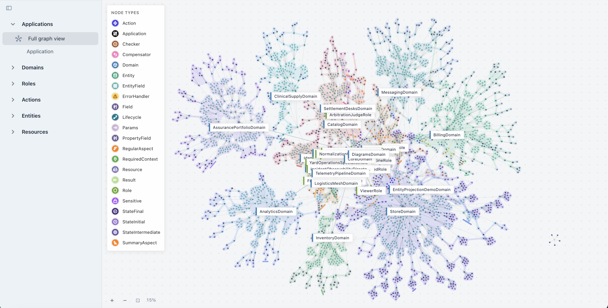
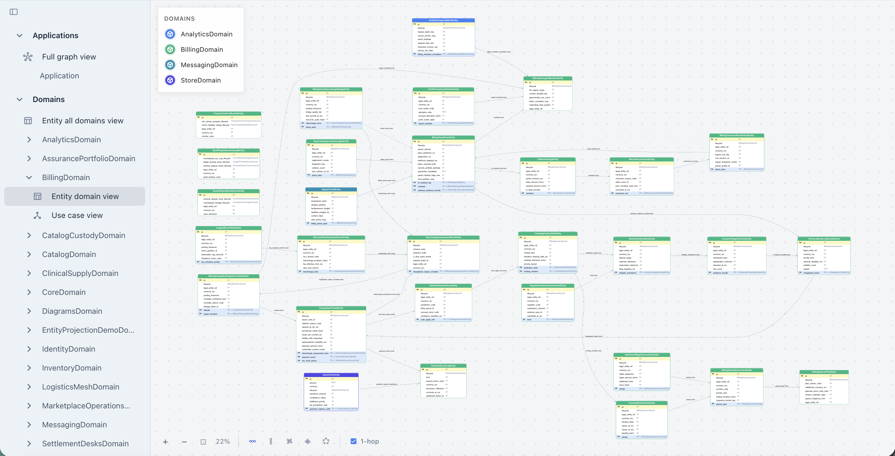
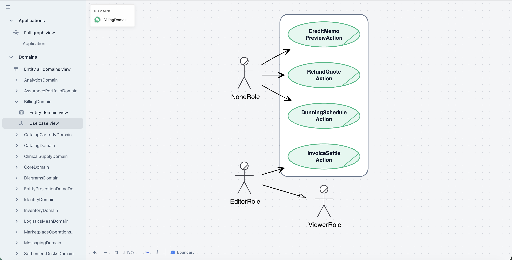
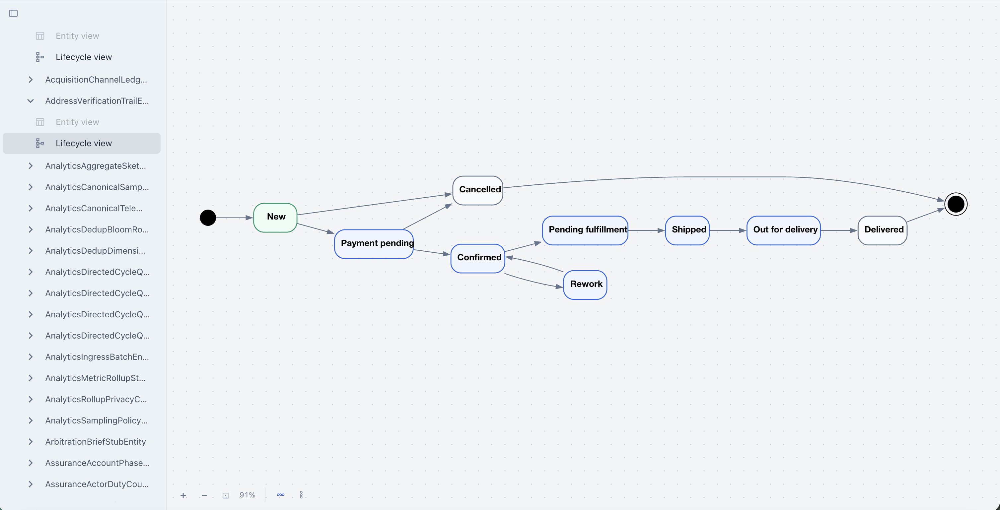

<p align="center">
  <br><br>
  <a href="https://www.python.org/downloads/"></a>
  <a href="https://github.com/bystrovmaxim/aoa"></a>
  <a href="https://github.com/bystrovmaxim/aoa/actions/workflows/ci.yml"></a>
  
  <a href="client/README.md"></a>
  
  
</p>

# aoa-maxitor: A System You Can See

Most architecture diagrams live in Confluence or Miro and go stale faster than they are drawn. A month after release the schema no longer matches reality: new domains appear, operation steps are renamed, dependencies change. The gap between what is written and what runs is a familiar problem.

**Maxitor** breaks that cycle: diagrams are not drawn by hand. They are generated from the same code that actually runs. Code changes — the diagram changes. Open a browser — see the current system. Diagrams stay current because they are built from the same intents that execute in code. Intent changes — the diagram reflects it.

## What Is Maxitor

Maxitor is a React SPA that turns AOA project code into live interactive diagrams. The data source is not YAML or Confluence annotations — it is the code itself: domains, actions, dependencies, entities, lifecycle state machines. Everything declared in code via intents automatically appears in the graph.

Maxitor can show four views of the system:


| View            | Shows                                                                       |
| --------------- | --------------------------------------------------------------------------- |
| **Full graph**  | Everything: domains, Actions, pipeline steps, resources, dependencies, links |
| **ERD**         | Entities, fields, relations, and cardinality by domain                      |
| **Use case**    | Roles and Actions each role can access                                      |
| **Lifecycle**   | Finite state machine for a specific entity                                  |


---

## 1. Full Graph: The Whole System as One Map

The full graph is an interactive network of all elements in an AOA system. One view shows what used to take days of onboarding.

<p align="center">
  
</p>

The graph shows nodes of different types, each with a color label:

- **Domain** — groups Actions by business area
- **Action** — business operation with name and description
- **RegularAspect / SummaryAspect** — pipeline steps inside an Action
- **Compensator** — rollback steps (saga)
- **ErrorHandler** — error handlers
- **Resource** — dependencies via `@depends`
- **Entity / EntityField** — data model
- **Lifecycle** — state machine
- **Role** — access roles
- **Params / Result / Field** — contract of each Action

The left panel filters by groups: Applications, Domains, Roles, Actions, Entities, Resources. The graph is interactive — zoom, pan, isolate a cluster.

**Key effect**: a new developer understands system structure in five minutes without reading code. A reviewer sees what changed without diffs across dozens of files.

---

## 2. ERD: Data Model From Code

The ERD tab shows entity schemas by domain: fields, types, relations, cardinality.

<p align="center">
  
</p>

The left panel navigates domains. For each domain:

- **Entity domain view** — ERD for that domain only
- **Use case view** — roles and Actions in the domain

On the diagram you see:

- Which entities belong to the domain
- Their fields and types
- How entities are linked (`AssociationOne/Many`, `AggregateOne/Many`, `CompositeOne/Many`)
- Bold lines — relation direction
- Header color — domain membership

The ERD is built from classes inheriting an entity kind base and their relation fields. Each exported Entity node carries `properties.entity_kind`; Maxitor preserves it in the `entity` table. This distinguishes independent objects, technical associations, owned parts, specializations and reference values. State types are excluded from ordinary Entity nodes and belong to lifecycle diagrams instead.

Kind metadata does not yet hide technical associations on its own. Rebuild graph exports created before the required property was introduced. The [graph-to-store example](../../examples/step_20_entity/11_graph_kind.py) ([notebook](../../examples/step_20_entity/11_graph_kind.ipynb)) demonstrates the value arriving unchanged in Maxitor.

### A closed dictionary, and a field that references one

A dictionary is an Entity node whose `entity_kind` is `enum`; it carries `properties.values`, the values it declares, each one its reference object `{code, display_name, properties}`. The ERD card does not draw them: it is an ordinary card of the dictionary's own fields, with no value rows, no codes and nothing standing in their place. The values stay in the graph and in the ERD response for every consumer that reads them, so a catalogue with ninety-three entries no longer sets the height of the diagram.

A field typed by a dictionary carries `reference_qualname`, the dictionary's interchange id. The card shows the dictionary's short name after the type, prefixed with an arrow. The axis container's label names the dictionary that classifies it.

The ERD payload still carries each value's `code`, `display_name` and descriptive `properties` as name/value text items, in declaration order and in the strict response shape; the full graph retains their original object form. The card draws none of it. The renderer names no domain-specific field, and an ordinary entity has an empty value list.

Dictionary references arrive from the graph in JSON form, including any declared field
serializer's output. The server converts properties to `{name, value}` text items for
the strict ERD response schema; strings stay text and other values use JSON notation.
A saved graph that already includes those properties needs no rebuild for this display.

The server also supplies each specialization group's complete `label`, such as
`pressing (by VinylRecordKindEnumEntity)`. The client displays it once. `dictionary_label`
is no longer a member of the ERD group response; it remains model metadata on the graph
edge. The [group-label example](../../examples/step_21_relations/51_group_label.py) and
[notebook](../../examples/step_21_relations/51_group_label.ipynb) print the actual response.

See the [dictionary example](../../examples/step_20_dictionaries/09_erd.py) and [Maxitor tutorial](../../docs/tutorials/step-26-maxitor.md#dictionaries-in-the-entity-diagram) for the actual output.

---

## 3. Use Case: Who Can Do What

The use case view shows roles and Actions they can access via `@check_roles`. This is not hand-written documentation — it is read directly from `@check_roles` annotations in code.

<p align="center">
  
</p>

Useful for:

- Access audits — see who can run which operations
- Business discussions — answer “can a manager do this?” without opening code
- Reviewing role changes

---

## 4. Lifecycle: State Machine

For each entity with a `Lifecycle` field, Maxitor builds a finite automaton graph: states, transitions, initial and final vertices.

<p align="center">
  
</p>

Especially valuable when an entity lifecycle is non-trivial — e.g. an order with a dozen states. Instead of reading automaton code line by line, you see the full transition graph.

Endpoint: `GET /api/v1/lifecycle-finite-automaton?entity_qualname=...`

---

## 5. How It Works Inside

Maxitor itself is an AOA application. Its backend is written with Actions, wired through `FastApiAdapter`, and uses DuckDB to store a graph snapshot.

```
AOA code (domains, Actions, entities)
        ↓
NodeGraphCoordinator — walks all elements
        ↓
GraphStore — one DuckDB snapshot per source (?source=)
        ↓
GraphSourceMiddleware → FastAPI Actions → JSON endpoints
        ↓
React SPA (G6 + Graphviz WASM)
```

On backend startup, `NodeGraphCoordinator` scans all registered AOA code and builds the process graph. A diagram read names the AOA service it wants as `?source=<graph-json URL>`; the graph store builds that service's DuckDB snapshot on the first read and keeps it, so a repeat open costs nothing and two users of two services never see each other's graph. At most 50 graphs are held, at most 4 builds run at once, and a graph unread for an hour is removed.

**Important**: the React SPA is fully separate from the backend. Two independent processes. In production you can build static SPA assets and serve them from a CDN, with the API hosted separately.

---

## 6. API Endpoints

All diagram endpoints are AOA Actions exposed via `FastApiAdapter`:

Every diagram read names the source it is for:

```
GET /api/health                          — health check, plus the store's load

GET /api/sidebar?source=<url>            — navigation: domains, entities

GET /api/v1/full-graph?source=<url>      — full graph (G6 payload)
GET /api/v1/list-domains?source=<url>    — domain list with colors
GET /api/v1/list-entities?source=<url>   — ERD slice by domain
GET /api/v1/list-node-types?source=<url> — graph node types
GET /api/v1/domain-use-case-diagram?source=<url>&domain_id=…
GET /api/v1/lifecycle-finite-automaton?source=<url>&lifecycle_graph_node_id=…

POST /api/load  {"service_url": "<url>"} — rebuild that one source
```

`source` is the AOA service's `graph-json` URL, URL-encoded. A read that names no source answers `400` and says which parameter is missing; a source that cannot be built answers `422` with the reason; a server with no free build slot answers `503` with `Retry-After` and the client retries. A read whose source is not built yet builds it on the spot — it never answers "not loaded".

`POST /api/load` is not "load into the slot" any more: it rebuilds the source it names and leaves every other source alone. In the SPA the same action is the **"Reload from service"** button next to the open source; a deep link only reads and never reloads.

`GET /api/health` reports the store, so an operator can watch it without a debugger:

```json
{"status": "ok", "graphs_held": 3, "builds_running": 4, "builds_queued": 2}
```

Swagger UI: `http://127.0.0.1:8000/docs`

JSON from endpoints can be embedded in your portal, CI pipeline, or documentation tooling. A runnable tour of every case — two sources side by side, `400`, `422`, `503`, reload, eviction, a burst — is [examples/step_26_maxitor/02_api_graph_per_source.py](../../examples/step_26_maxitor/02_api_graph_per_source.py) and its [notebook](../../examples/step_26_maxitor/02_api_graph_per_source.ipynb).

---

## 7. How to Run

### Backend

```bash
uv run task maxitor-api
```

Starts FastAPI at `http://127.0.0.1:8000`. Environment:

| Variable | Default | Meaning |
|---|---|---|
| `MAXITOR_API_HOST` | `127.0.0.1` | where uvicorn listens |
| `MAXITOR_API_PORT` | `8000` | port |
| `MAXITOR_MAX_GRAPHS` | `50` | most graphs one process holds; the least recently read is evicted |
| `MAXITOR_GRAPH_IDLE_SECONDS` | `3600` | a graph unread this long is removed (one hour) |
| `MAXITOR_MAX_CONCURRENT_BUILDS` | `4` | builds running at once; further reads wait, then get `503` |

A held graph is much smaller than it used to be. The build keeps no index and no primary key, because no diagram query reads through one: the reference service's graph takes about 13 MiB of database memory (43.5 before #268), and the process gains about 24.5 MiB per graph on macOS and 16.7 MiB on Linux. At the default limit of fifty graphs that is roughly 1.1 GiB of process instead of 2.7. The diagrams and their timings are unchanged, and the build is slightly faster. A graph that lists the same node id twice in one table is still refused, now with a message that names the id and the table.

Memory after a graph is dropped depends on the system. On Linux the process returns it: with ten reference graphs held the process was about 309 MiB, and about 192 MiB after all were dropped. On macOS the process keeps its peak and reuses it, so there the process size is set by the most graphs held at once. DuckDB's `allocator_bulk_deallocation_flush_threshold` and `allocator_flush_threshold` lower the Linux peak by 10–35 MiB but do not change the answer; the measurement is in `specs/025-graph-index-memory/research.md` (R10).

### Frontend (dev)

```bash
cd packages/aoa-maxitor/client
npm install
npm run dev
```

SPA at `http://127.0.0.1:5173`. Vite proxies `/api` to `http://127.0.0.1:8000`.

### Production

```bash
VITE_MAXITOR_API_BASE_URL=https://api.example.com npm run build
```

Builds static SPA assets. Deploy: SPA on CDN or nginx, API in a separate container.

---

## 8. Client Architecture (`client/src`)

The React SPA is layered:


| Layer                  | Contents                                                          |
| ---------------------- | ----------------------------------------------------------------- |
| `app/`                 | Entry: `App.tsx`, `AppProviders.tsx`. No business logic           |
| `components/`          | All UI: `layout/`, `pages/`, `navigation/`, `diagrams/`          |
| `components/diagrams/` | `FullGraphViewer/` (G6), `ErdViewer/` (Graphviz WASM)             |
| `api/`                 | HTTP clients mirroring FastAPI routes                             |
| `model/`               | TypeScript contracts between UI and API                           |
| `lib/`                 | Pure helpers, layout constants                                    |
| `styles/`              | MUI theme                                                         |


Graph rendering:

- **G6** (`@antv/g6`) — full graph, force-directed layout
- **`@hpcc-js/wasm-graphviz`** — ERD, deterministic Graphviz layout

---

## 9. Installation

```bash
pip install aoa-maxitor
# or in the monorepo
uv sync
```

Dependencies: `aoa-action-machine`, `fastapi`, `uvicorn`, `duckdb`.
