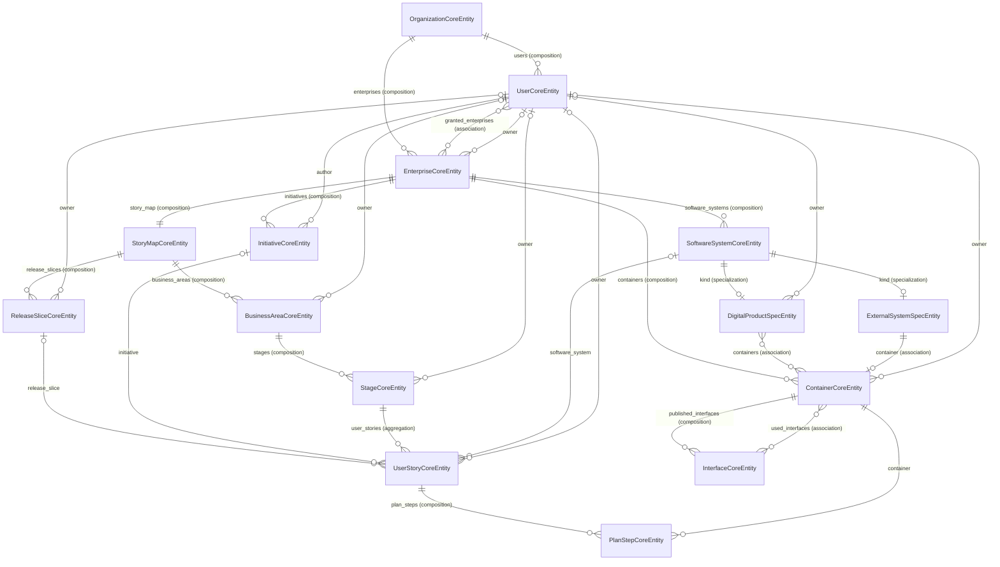

<!-- translated-from: data-model.ru_draft.md @ 2026-11-04T19:50:28Z (filesystem mtime; draft is gitignored, no git history) · sha256:224620da47bf -->
# Maxitor concept: data model

The model is written as code, not as a picture. It is AOA entities in [model/enterprise_model.py](model/enterprise_model.py), and the code will later be built around them. All of this is design, so the whole model lives in the specification folder, not in the packages' code. The model's graph is built by the same standard mechanism as the graphs of the demo and Maxitor: the script [model/build_graph.py](model/build_graph.py) writes it to [model/graph.json](model/graph.json), and Maxitor shows it. The `model` folder is a component with its own [version.toml](model/version.toml), so the graph has a version and the graph history reads it.

Every term from the [dictionary](terms.md) that names a thing Maxitor stores becomes an entity. A term that is a rule becomes a constraint next to the entities it concerns.

The words "belongs to" and "owner" mean different things here. "Belongs to" is composition: a part lives inside a whole, for example a container inside an enterprise. An **owner** is a user who is accountable for something.

---

## Domains

The model is split into three AOA domains. An AOA domain is a part of Maxitor itself, not a **business area** on the enterprise's map.

| Domain | What it holds | Entities |
|---|---|---|
| `organization` | Who works in Maxitor and what they may work with | `OrganizationCoreEntity`, `UserCoreEntity`, `EnterpriseCoreEntity` |
| `story_map` | The enterprise's story map and the plans of its stories | `StoryMapCoreEntity`, `ReleaseSliceCoreEntity`, `InitiativeCoreEntity`, `InitiativeKindEnumEntity`, `BusinessAreaCoreEntity`, `StageCoreEntity`, `UserStoryCoreEntity`, `PlanStepCoreEntity` |
| `landscape` | The enterprise's C4 landscape | `SoftwareSystemCoreEntity`, `SoftwareSystemKindEnumEntity`, `DigitalProductSpecEntity`, `ExternalSystemSpecEntity`, `ContainerCoreEntity`, `InterfaceCoreEntity` |

The enterprise lives in `organization`. It ties the account to the map and the landscape, and users' access is set on it. Links between domains are ordinary entity links: for example, the owner of a business area or of a container is a user from `organization`.

## Entities and links



| Entity | Term | Fields | Kind |
|---|---|---|---|
| `OrganizationCoreEntity` | **Organization** | `id`, `name`, `sso_domain` | Core |
| `UserCoreEntity` | **User** | `id`, `name`, `email`, `status`, `is_admin` | Core |
| `UserStateEntity` + `UserLifecycle` | **User lifecycle** | four states and the moves between them | State |
| `EnterpriseCoreEntity` | **Enterprise** | `id`, `name` (it also names the end-to-end process), `description`, `is_open`, `owner` | Core |
| `StoryMapCoreEntity` | **User story map** | `id` | Core |
| `ReleaseSliceCoreEntity` | **Release slice** | `id`, `name`, `goal`, `position`, `target_date`, `owner` | Core |
| `InitiativeCoreEntity` | **Initiative** | `id`, `name`, `kind`, `status`, `author` | Core |
| `InitiativeStateEntity` + `InitiativeLifecycle` | **Initiative lifecycle** | four states and the moves between them | State |
| `InitiativeKindEnumEntity` | initiative kinds | `pr_faq` (PR/FAQ) | Enumeration |
| `BusinessAreaCoreEntity` | **Business area** | `id`, `name`, `position`, `owner` | Core |
| `StageCoreEntity` | **Stage** | `id`, `name`, `position`, `owner` | Core |
| `UserStoryCoreEntity` | **User story** | `id`, `title`, `text`, `position`, `status`, `owner`, `software_system`, `release_slice`, `initiative` | Core |
| `UserStoryStateEntity` + `UserStoryLifecycle` | **User story lifecycle** | six states and the moves between them | State |
| `PlanStepCoreEntity` | **Plan step** | `id`, `title`, `text`, `position`, `status`, `container` | Core |
| `PlanStepStateEntity` + `PlanStepLifecycle` | **Plan step lifecycle** | `todo` (not done, initial) → `done` (done, final) | State |
| `SoftwareSystemCoreEntity` | **Software System** (generalization) | `id`, `name`, `description`, `kind` | Core |
| `SoftwareSystemKindEnumEntity` | Software System kinds | `digital_product`, `external_system` | Enumeration |
| `DigitalProductSpecEntity` | **Digital product** (specialization) | `id`, `owner` | Specialization |
| `ExternalSystemSpecEntity` | **External system** (specialization) | `id` | Specialization |
| `ContainerCoreEntity` | **Container** (ours or external) | `id`, `name`, `description`, `kind`, `live_graph_url`, `graph_history_url`, `service_url`, `owner` | Core |
| `InterfaceCoreEntity` | **Interface** | `id`, `name`, `description`, `protocol` | Core |

The table lists the fields that set an entity apart. Besides them, every entity has two shared fields; see "Creation and change dates".

Every link has an inverse side (`Inverse`): an enterprise sees its map, and the map sees its enterprise. A user sees everything they own — `owned_enterprises`, `owned_release_slices`, `owned_business_areas`, `owned_stages`, `owned_user_stories`, `owned_digital_products`, `owned_containers` — and the initiatives they created, `authored_initiatives`.

## Rules

### Creation and change dates

- Every entity has `created_at` — when the record was created — and `updated_at` — when it last changed. An empty `updated_at` (`None`) means the record has not changed yet.
- These two fields always come last in an entity, after all other fields and links.
- Dictionaries and lifecycle states (`SoftwareSystemKindEnumEntity`, `InitiativeKindEnumEntity`, `InitiativeStateEntity`, `PlanStepStateEntity`, `UserStoryStateEntity`, `UserStateEntity`) do not have them: their values are declared in the model's code and change with it, not at work.
- The fields are written in every class explicitly, not through a shared base class. A base class would put them first, and their place is at the bottom.

### Organization, users and access

- Every enterprise and every user belongs to exactly one organization (composition). Organizations are isolated from each other.
- Access to an enterprise is set by the `is_open` flag and the many-to-many link `granted_users` ↔ `granted_enterprises`. An open enterprise is available to every user of its organization, and it needs no list. A closed one is available only to the users in `granted_users`. There are no other degrees of access yet.
- While an enterprise is open, the `granted_users` list is kept but has no effect. If the enterprise is closed, the users in the list get access at once. If a closed one is opened, nobody loses access.
- Explicit access is a plain association, not a separate entity: the link has no data of its own yet, only "listed or not".
- An **organization administrator** is a user with `is_admin`. An administrator invites, blocks, unblocks and removes users, appoints administrators, creates enterprises, appoints the owner of an enterprise that has no active owner, and connects SSO. There may be several administrators.
- The enterprise's owner (`owner`) opens and closes the enterprise (`is_open`) and changes `granted_users`. If there is no active owner (`owner` is empty, blocked or removed), the administrator does this.
- The administrator changes an enterprise's `owner`, and only when there is no active owner: when the enterprise is created, or after the owner was blocked or removed. An active owner cannot be replaced: otherwise the administrator would have a back door into a closed enterprise whose access the owner grants.
- A closed enterprise without access is visible to the administrator only in administration: its name, `is_open`, owner and `granted_users`. The administrator sees its map and landscape only after adding themselves to `granted_users`. This is an ordinary catalog change, so it stays in the history with its author and time.
- An organization's `sso_domain` is the email domain of its SSO. Whoever first signs in through SSO with an address of this domain appears straight in the `active` state, without an invitation. Empty means SSO is not connected, and users appear only by invitation.
- A user is not a C4 Person. A Person uses the digital products; a user works in Maxitor.
- A user's state is kept in the `status` field and follows the `UserLifecycle`:

| State | Meaning | Can move to |
|---|---|---|
| `invited` — Invitation sent (initial) | the record exists; the person has not accepted the invitation yet | `active`, `blocked`, `removed` |
| `active` — Active (initial) | a real user: accepted the invitation or was created active | `blocked`, `removed` |
| `blocked` — Blocked | cannot work in Maxitor | `active` (unblock), `removed` |
| `removed` — Removed (final) | removed from the organization for good | — |

- There are two initial states: a user can be invited, or created active straight away.
- The final "Removed" state is needed not only for its meaning. AOA requires a final state to be reachable from every initial one. "Blocked" cannot be final, because a block can be lifted.
- A blocked or removed user does not work in Maxitor. What they owned stays theirs until the owner is changed, and it is visible that the owner is blocked or removed.

### Owners

- An enterprise, a release slice, a business area, a stage, a user story, a digital product and our container have an owner. Each of them has zero or one owner (`owner`, an optional link). An empty owner is a visible signal that nobody has been made accountable yet.
- An external system and an external container have no owner: we do not run them.
- A digital product's owner sits on the specialization, not on the Software System head, because an external system has no owner.

### Story map

- An enterprise has exactly one map, and every map belongs to exactly one enterprise. So the link is a one-to-one composition.
- A business area belongs to the map, and a stage to its business area (composition). Both stay Core.
- Business areas, stages, release slices and user stories are ordered. A business area's `position` sets its place on the backbone from left to right, a stage's — its place inside the business area from left to right, a release slice's — the slice's place from top to bottom. A story's `position` is its priority inside the "stage × release slice" cell from top to bottom. So priority and slice never contradict each other.

### Release slices

- A release slice is a horizontal slice of the map below the backbone: which stories under all the stages make up one portion of value, for example an MVP or "Release 2". A slice belongs to the map (composition), and a map has any number of them.
- A story lies in zero or one slice (`release_slice`). An empty slice means the story is not planned yet: on the map it lies below all the lines. If a story was not finished, it moves to the next slice; it is never put into two at once.
- A slice has a goal (`goal`) — what people will get when its stories are done — and an optional target date (`target_date`).
- A release slice is not a code version. A container's version (`version.toml`, a GitHub Release) is another idea: one slice holds work in many containers with their own versions.
- A slice has no lifecycle of its own yet. It will be added later.
- Slices belong to the map, not to the enterprise.
- A user story is a thing of its own. It can be moved under another stage and stays the same story. So a stage only aggregates stories and does not contain them.

### Initiatives

- An initiative answers "why" for a group of stories. It belongs to the enterprise (composition).
- An initiative has a kind from the `InitiativeKindEnumEntity` dictionary; for now there is one, PR/FAQ. The kind is a dictionary, not a lifecycle: it is a kind of justification, not a state, and it has no moves.
- An initiative has zero or more stories, and a story has zero or one initiative (`initiative`). A story without an initiative happens, for example an idea before its PR/FAQ or a technical story, and it is a visible signal.
- An initiative has exactly one author — the user who created it (`author`). The author never changes and stays the author even if blocked or removed. The author is not an owner; an initiative has no owner yet.
- For now an initiative has only a name. Its content will be designed separately: it will be a set of nodes, not a document.
- An initiative's state is kept in the `status` field and follows the simplified `InitiativeLifecycle`:

| State | Meaning | Can move to |
|---|---|---|
| `draft` — Draft (initial) | the initiative is being written and discussed | `approved`, `rejected` |
| `approved` — Approved | it was decided to do it; stories go under it | `done`, `rejected` |
| `done` — Done (final) | what it was started for is done | — |
| `rejected` — Rejected (final) | it was decided not to do it | — |

- The lifecycle is simplified: it has no move back from approved to draft and no pause. If they are needed, they are added to the lifecycle, and the field stays the same.

### A story and its plan

- A story points to zero or one Software System (`software_system`): the digital product or external system where the requirement arises. The link sits on the Software System head, not on the digital product, because a requirement may concern an external system too. It is empty only before mob elaboration.
- On mob elaboration a story is split into plan steps. Steps belong to the story (composition) and are ordered (`position`). Every step points to exactly one container.
- A step's container does not have to belong to the story's Software System. A story of one product may need work in a container of another, and this makes the cross-product impact visible.
- A step on an external container is not our work but a request to the other side.
- A step's readiness follows the `PlanStepLifecycle`: for now it has two states, `todo` (not done, initial) and `done` (done, final). A new step is not done, because `todo` is the initial state. A lifecycle rather than a flag was chosen so that it can grow: a new state is one line and its moves, and the step's field stays the same. A lifecycle rather than a dictionary, because the path between the states matters for a step too, and Maxitor draws it as a diagram.
- A story's state is kept in the `status` field and follows the `UserStoryLifecycle`. It is not a dictionary but an AOA lifecycle: it sets not only which states exist but also which moves are allowed. Maxitor draws it as a state diagram: as a separate view in the sidebar and as a miniature in the story's card.

| State | Meaning | Can move to |
|---|---|---|
| `backlog` — Idea (initial) | written on the map, not worked out | `elaboration`, `rejected` |
| `elaboration` — In elaboration | mob elaboration is under way | `ready`, `backlog`, `rejected` |
| `ready` — Ready | it has a Software System and a plan of steps | `in_progress`, `elaboration`, `rejected` |
| `in_progress` — In progress | the steps are being done | `done`, `elaboration`, `rejected` |
| `done` — Done (final) | all steps are done, the story is accepted | — |
| `rejected` — Rejected (final) | it was decided not to do it | — |

- A story's state is tied to its plan steps by two rules. "Ready" — only if the story has a Software System and at least one step. "Done" — only if all steps are done.
- Why the story's state is stored rather than derived from its steps: a story has states its steps do not show — idea, elaboration, rejected. And "done" also means "accepted": done steps are needed for it but are not enough.
- A story can be rejected from any unfinished state. From elaboration it can go back to the ideas, and from "ready" and "in progress" back to elaboration if the plan had to be revised.

Why two levels of linking instead of one: neither follows from the other. A story's containers do not tell which Software System it was made for: the residents' mobile app is shared by FSM and billing. The Software System does not tell which containers the story changes: a product has many of them, and the story touches only some. So the "why" is recorded on the story, and the "where the work is" on its steps.

### Landscape

- The **enterprise boundary** is a rule, not an entity. Digital products and our containers lie inside the enterprise's boundary; external systems and their containers stand on it. Each of them is recorded in exactly one enterprise, so the boundary is always unambiguous.
- A **Software System** is a generalization. The name, description and enterprise live in the `SoftwareSystemCoreEntity` head, and what sets a kind apart lives in the specializations. A digital product gathers our containers; an external system has exactly one container. Every Software System has exactly one kind, the `SoftwareSystemKindEnumEntity` dictionary sets it, and a specialization has the same `id` as its head.
- All containers, ours and external, belong to the enterprise. A product only gathers containers (many to many), because one container may work for several products: the residents' mobile app works for both FSM and billing. An external system only refers to its container.
- A container is one of two sorts. An **external** one has `external_system` set and belongs to no product. **Ours** has an empty `external_system` (`None`). There is no separate "sort" field: the link defines the sort.
- An external system has exactly one container — its entry point. At C1 the system itself is visible, and at C2 and below that container takes part instead of it.
- A container publishes its interfaces: there may be many, and every interface is published by exactly one container (composition, `published_interfaces` ↔ `publisher`). Other containers use these interfaces: many to many (`used_interfaces` ↔ `consumers`). The same set of endpoints on another protocol is a separate interface. In an AOA service one interface is one adapter.
- **What is entered by hand and what is derived.** By hand: the list of Software Systems, which containers each one holds, the containers themselves and their links — none of this is in the code. The interfaces of our container and what it uses are derived from its code. An external container has no source code, so its interfaces and what it uses are entered by hand. Details are in `catalog-filling.md`.
- A container's `kind` is a string for now (service, database, mobile app, web app, queue). When the list of kinds settles, it can become an enumeration.
- In the model's code `ContainerCoreEntity` and `UserCoreEntity` are declared before the Software System classes. If an entity is declared after the specializations that refer to it, loading the model recurses forever. This is an AOA bug, bystrovmaxim/aoa#415.

### Comparing two moments

- A comparison takes two saved states of the catalog, A and B, and matches records by `id`, as the graph comparison in the protocol does. A record only in B is added, only in A — removed, in both but with a difference — changed.
- Moving a story is a change of its `stage` or `release_slice`, not a removal plus an addition. A rename is a change of `name` or `title`.
- For a changed record the comparison names every changed field with its value in A and in B, and the author and time of the change.
- Stories and initiatives are never deleted, so in a comparison they are only added or changed. A rejection is a change of `status`.
- A comparison is not catalog data: it is computed from two states and writes nothing.

### Editing and deletion

- Every edit is one catalog change with its author and time. The time track is built from the changes, and any of them can be undone. A past snapshot is read only.
- Any user with access to the enterprise may edit. The owner is accountable for what they own, but others edit too.
- The model's proposals on mob elaboration are not catalog data. An accepted proposal becomes an ordinary edit by whoever accepted it: a step or a story's link to a Software System carries no separate "from the model" mark.
- Only what nothing refers to is deleted:

| What | When it can be deleted | What to do instead |
|---|---|---|
| `ContainerCoreEntity` | it has no plan steps (`plan_steps`) and nobody uses its interfaces (`consumers`) | remove the steps or the links, then delete |
| `SoftwareSystemCoreEntity` | it has no stories (`user_stories`) | move the stories to another Software System |
| `StageCoreEntity`, `ReleaseSliceCoreEntity` | they have no stories | move the stories |
| `BusinessAreaCoreEntity` | it has no stages | delete or move the stages |
| `PlanStepCoreEntity` | always: nothing refers to a step | — |
| `UserStoryCoreEntity`, `InitiativeCoreEntity` | never | reject: `rejected` is a final state of their lifecycle |

- A container's interfaces are deleted together with it (composition).
- An external system is deleted only together with its container, because without it the container would become ours. So both conditions apply to it: it has no stories, and its container can be deleted. An external system's container is never deleted on its own.

### Constraints checked separately

The type of a link cannot express them:

- a user in `granted_users` and the enterprise are from the same organization;
- only a record nothing refers to is deleted (the table in "Editing and deletion");
- an organization always has at least one active user with `is_admin`: the last one cannot be blocked, removed or lose the flag;
- the owner of a closed enterprise is in its `granted_users`;
- an owner has access to the enterprise that holds what they own: the enterprise is open, or the owner is in `granted_users`;
- an external container has neither products nor an owner;
- graph links (`live_graph_url`, `graph_history_url`) exist only on our container, and `service_url` only on an external one;
- all containers of a product and all interfaces a container uses are from the same enterprise;
- every external system has exactly one container, and that container is external;
- a container does not use its own interface;
- a story's Software System and the containers of its steps are from the same enterprise as the story;
- a story's release slice lies on the same map as its stage;
- a story's initiative is from the same enterprise as the story;
- an initiative's author is a user of the same organization as its enterprise;
- a story in the "ready" state or later has a Software System and at least one step;
- a story in the "done" state has only done steps.

## C4 levels in the model

The model stores only the two upper C4 levels. Everything below, Maxitor takes from the container's graph through its links.

| C4 level | What it is for us | Where it comes from |
|---|---|---|
| C1 — System Context | Software Systems: digital products and external systems on the enterprise's boundary | stored in the model |
| C2 — Container | containers and the interfaces that link them | stored in the model |
| C3 — Component | how a container is built: for an AOA service its domains, actions, entities and adapters | the container's graph via `live_graph_url` and `graph_history_url` |
| C4 — Code | the steps of actions and their bodies | the same graph and the code itself |

The line runs along the container, because below the container only its code knows the truth. C3 and Code are not copied into the catalog: a copy would drift away from the code with the first commit. A container only points to its graph, and Maxitor reads it from where the code itself builds it. So going down to C3 is following the container's link, not another level kept by hand.

## A container and its graph

This is what ties the landscape to the code. Without these links a container is just a row in the catalog. With them it points to its real graph, and Maxitor opens it the same way it opens any service or history today.

| Field | What it holds | How Maxitor opens it |
|---|---|---|
| `live_graph_url` | the address of the running container's live graph: the service or its graph-json | like the address in the "AOA SERVICE URL" field: the graph the service serves now |
| `graph_history_url` | a link to the container's graph file on GitHub | as a public history: every graph version by commit; with the component's version number if the link comes with its `version.toml` (the `version_link` parameter) |
| `service_url` | a web link to an external service, for example its website or API documentation | as an ordinary link: an external container has no graph |

- Graph links exist only on our container, and both are optional: it may have neither a running service nor a graph in a repository, for example a database. An external container has no graph; instead it has the `service_url` link to the service itself.
- `graph_history_url` holds only a public link to the graph file. It holds no access keys: for a private history Maxitor puts the key after `#key=`, and a key in the data model would be a leak. How a container with a private history gets access is to be decided separately.
- Both links point to the same container from two sides: live is what runs now, the history is what lies in the code and how it changed. If they differ, that is a difference between the code and what is running, and Maxitor can already show it.

## What is derived for viewing

The interface shows these things, but the model does not store them: they are derived from what is already there.

| What | Derived from |
|---|---|
| A Software System's group on the C1 landscape | the business area where the Software System's stories lie (`UserStoryCoreEntity.software_system` → stage → business area). A Software System without stories has no group, and neither has an external system |
| A link between two groups on the landscape | the sum of the interfaces between the Software Systems of these groups |
| An initiative's products | the Software Systems of its stories |
| Links between Software Systems | the links of their containers (see below) |

## Links are built at the container level

A Software System and its kinds are logical labels. Only containers have real links, and all of them work the same way: a container uses an interface of another container. Links between Software Systems are derived from them.

| What is linked | How it is recorded |
|---|---|
| Container → container (ours or external) | Recorded: container A uses, in `used_interfaces`, an interface whose `publisher` is container B. For our A this is derived from its code; for an external one it is entered by hand |
| Digital product → digital product | Derived: some container of one product uses an interface of some container of the other |
| Digital product → external system | Derived: some container of the product uses an interface of the external system's container |

The links and interfaces of our container are derived from its code and are not entered by hand. An external container has no source code, so its interfaces and what it uses are entered by hand. How this works, and what the graph lacks for it today, is described in `catalog-filling.md`. There is no direct "container → container" field and there will not be one: the link from A to B is derived from the pair "A uses an interface that B publishes". A separate field would be a second record of the same fact.

`SoftwareSystemCoreEntity` and its specializations have no fields linking one Software System to another, and they will not have them.

### Why

1. **Only what runs can call anything.** A digital product has no process, port or code of its own. When people say "FSM calls the state housing system", a specific service makes the call. A link recorded on the product would describe something that does not actually happen.
2. **One source of truth.** If links were recorded both on products and on containers, the two records would drift apart over time, and nobody would know which one is right. When a Software System's link is derived, it always matches the containers' links.
3. **The source of truth is the code.** A container link can eventually be checked against the code and against tracing. A product link has nothing to be checked against: a product has no code. So links declared by hand on products would again become YAML kept by hand.
4. **This is how C4 works.** Links between systems on the System Context diagram are a roll-up of the links of their containers.
5. **An external system has a container too, so there are no exceptions.** An external system is needed at C1. If it took part in links directly, a second link, "container → system", would live next to "container → container", and the rule would have an exception. When an external system has its own container, all links at C2 are of one kind. That container, like ours, has interfaces, a protocol and, if known, a place on GitHub.
6. **A link goes through an interface, not directly.** Two containers may have several links between them: over different protocols and for different tasks, for example an admin API over HTTP and the same set of actions over MCP. A "container → container" link without an interface would glue them into one. Through an interface every link shows its protocol and its meaning. In AOA an interface is the same as an adapter, so it can be found in the code.

### What a derived link does not say

A container may work for several products, so its link counts for each of them. If the residents' mobile app belongs to both FSM and billing and calls the payment service, both "FSM → payments" and "billing → payments" are derived. A derived link says the products can exchange data, but not that they do so for this particular product. If one needs to know which product a call is made for, that information has to appear on the container link itself.

## How to build and view the graph

Build the graph (the result is written to `model/graph.json`):

```bash
cd /Users/bystrovmaxim/PythonDev/aoa/.claude/worktrees/maxitor-concept && uv run --extra dev python specs/059-maxitor-concept/model/build_graph.py > specs/059-maxitor-concept/model/graph.json && uv run graph-builder validate specs/059-maxitor-concept/model/graph.json
```

View the graph: start `design-preview`, `maxitor` and `maxitor-client` from `.claude/launch.json` and open the ERD of the domain you need:

- organization: `http://localhost:5173/?source=http%3A%2F%2F127.0.0.1%3A8899%2Fspecs%2F059-maxitor-concept%2Fmodel%2Fgraph.json&view=domain-erd&domain=enterprise_model.OrganizationDomain`
- story_map: `http://localhost:5173/?source=http%3A%2F%2F127.0.0.1%3A8899%2Fspecs%2F059-maxitor-concept%2Fmodel%2Fgraph.json&view=domain-erd&domain=enterprise_model.StoryMapDomain`
- landscape: `http://localhost:5173/?source=http%3A%2F%2F127.0.0.1%3A8899%2Fspecs%2F059-maxitor-concept%2Fmodel%2Fgraph.json&view=domain-erd&domain=enterprise_model.LandscapeDomain`
